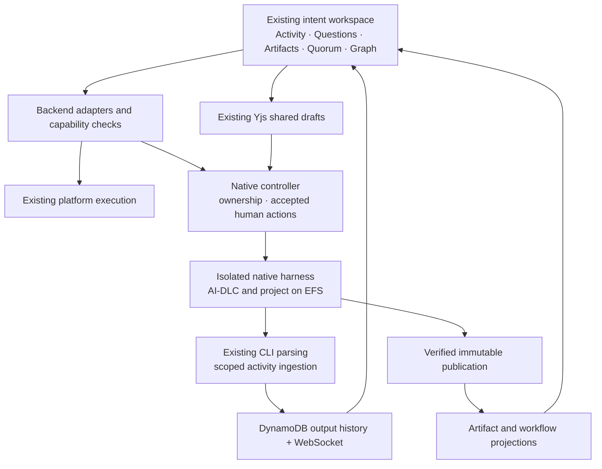

# Native execution: integration and qualification plan

Updated 30 September 2026. Branch: `feat/native-aidlc-execution`.
This is a proposed implementation sequence, based on the current source and
saved live-test evidence. This planning review does not deploy, start or approve
a run. It supersedes the next-step ordering in the earlier checkpoint documents.

## Outcome

Native execution should use the existing collaborative intent workspace:
streamed activity, persistent history, shared questions, artifact discussions,
Quorum assistance, approvals and graph navigation. Execution backend selection
should change the runtime and its adapters, while preserving the familiar
application experience.

The current native page established a useful execution/recovery test surface.
The next work integrates that foundation into the shared workspace. New native
features should not accumulate in a second full intent UI.

## Where we are

| Area                    | Evidence we have                                                                                                                                                               | Qualification still missing                                                                                                   |
| ----------------------- | ------------------------------------------------------------------------------------------------------------------------------------------------------------------------------ | ----------------------------------------------------------------------------------------------------------------------------- |
| Actual native execution | Codex starts the real Compose request, returns a plan/question, accepts the authorized clarification and returns the next response.                                            | Approved workflow through code generation, tests and completion.                                                              |
| Files and graph         | Immutable public files, saved responses and a generic file/response graph work in the native page, including reload and graph navigation.                                      | Existing artifact/stage presentation, semantic graph relationships, history and artifact-scoped discussions.                  |
| Recovery                | One real cold Codex session restored the same conversation and delivered the accepted clarification once. All 439 checkpoint files matched their exact S3 versions and hashes. | Other harnesses, larger workspaces, confirmed forced interruption, ambiguous in-flight work and live failed-status retry.     |
| Harnesses               | Earlier isolated question/answer/follow-up probes passed for Codex, Claude Code, OpenCode and Kiro.                                                                            | Complete shared-UI workflows and live recovery for all four. Kiro's actual cold CLI restore remains unqualified.              |
| Workflow sources        | Official public GitHub source configuration and package import passed live. Three-provider/private-source code and local fixtures exist.                                       | Private GitHub, public/private GitLab and public/private Bitbucket live acceptance, including revocation and import failures. |
| Human actions           | Ordinary native replies use authenticated, presentation-bound protected records and guarded dispatch.                                                                          | Structured answers and explicit workflow approvals through the existing collaborative controls.                               |
| Debug controls          | Platform settings save/reload correctly; required recovery is independent.                                                                                                     | Optional archive capture and retention enforcement are not wired up. Terminal-run resource cleanup also needs qualification.  |

The current flappy-bird test remains at an **unapproved** plan. Its pinned source
branch contains the scaffold, not the pipe implementation. Before testing an
actual pipe fix, select the intended source branch in a new draft or explicitly
decide to build the missing functionality. Preserve the current run and its pins.

Detailed receipts and limits are in
[the recovery checkpoint](native-session-recovery-plan.md#current-live-checkpoint)
and [delivery status](native-delivery-status.md).

## Decisions already made

- Native remains opt-in; existing platform executions keep their backend.
- All four harnesses remain in the finished milestone.
- Public/private GitHub, GitLab and Bitbucket sources remain in scope.
  Prebuilt packages are primary. Resolve the selected source's highest stable
  release by default, then retain immutable package, source and runtime pins.
- Runtime isolation and EFS project/workflow files remain. Harness executables
  and active harness homes use AgentCore local storage. No EC2 migration.
- No application timeout, token cap or spending cutoff is introduced for a
  model turn. Performance targets measure responsiveness and overhead.
- Human decisions require an authority boundary the native agent cannot write.
  Keep today's project-member permissions and existing membership source.
- Quorum is user-invoked discussion/assistance available on every artifact.
  It is not a voting-threshold feature. No new voting rules are proposed.
- Shared activity follows the existing run: reuse its parsing, DynamoDB output
  history, live delivery and transcript presentation. History remains visible
  after the run, independently of optional debug archives.
- Optional debug archives default off, with seven days as the default retention
  when enabled. Required recovery remains possible with debugging off.
- Advanced artifact edits, Quorum edit/apply, parallel execution and per-unit
  PRs remain deferred and disabled in both UI and API.
- Pre-provisioning remains deferred. Existing repository/OAuth follow-ups stay
  separate from this integration.

## How to integrate

### One workspace with backend adapters

Introduce a common workspace data and command contract behind the existing
intent context. Implement platform and native adapters, then use the existing
intent page, activity panel, artifact viewer, discussion provider and question
controls for both.

Native currently bypasses `IntentProvider` and `DiscussionProvider` in
`frontend/src/components/layout/AppShell.tsx`. Those providers also depend on
platform-specific DTOs and APIs. Simply enabling them, or removing capability
guards, would send native actions to the wrong backend.

The shared contract should expose identity/access, execution state, activity,
publications/artifacts, available workflow stages, pending interactions,
discussion anchors and supported actions. Composer may run before any workflow
stages exist; show that state directly without fabricating compiled stages.

Keep existing native URLs working as aliases to the shared workspace. Preserve
the existing native safeguards against stale fetches, publication changes,
revoked access and switching between runs.

The core workflow and filesystem determine workflow state and artifacts. The
protected controller owns accepted human actions and execution ownership.
Graph records and UI models are derived views. Shared drafts and assistant
messages do not confer approval authority.

### Reuse map

| Existing application capability                                                                | Native integration                                                                                                                                                                                               |
| ---------------------------------------------------------------------------------------------- | ---------------------------------------------------------------------------------------------------------------------------------------------------------------------------------------------------------------- |
| `IntentView`, `IntentContext`, `IntentActivityPanel`                                           | Supply native state through the shared contract; preserve platform behavior through its adapter.                                                                                                                 |
| `output-normalizer.js`, Codex/OpenCode parsers, existing Claude/text handling                  | Feed incremental native output through the existing parsing path. Add only missing transport handling, such as Kiro ACP events, and retain the common display model.                                             |
| DynamoDB `OUTPUT` rows, `agent.output`, lazy history/reconnect replay, `AgentOutputTranscript` | Reuse the output schema and read/replay behavior through a native-scoped persistence adapter. Do not create fake platform workflow state or grant native agents broad process-table access.                      |
| `QuestionEditor` and Yjs shared answers                                                        | Bind shared drafts to the actual native interaction, publication and question revision. Freeze the submitted value into the protected action record.                                                             |
| `GateCard` and existing review controls                                                        | Route explicit, valid decisions to native authority records and a verified workflow continuation adapter. Preserve one authorized member's submission semantics.                                                 |
| Artifact discussions and Quorum                                                                | Resolve native ownership, then provide the selected committed artifact revision and authorized discussion context. Allow invocation on every public artifact, including generic files. Keep edit/apply disabled. |
| `ArtifactViewer`, history and `GraphCanvas`                                                    | Reuse presentation; add native stage/artifact/question projections and revision-specific links. Translate runtime file citations into authorized artifact links.                                                 |

Existing platform output is persisted by
`lambda/shared/v2-process-store.js:appendOutput`, broadcast by
`lambda/agentcore/commands/run-stage.js`, and restored/reconciled by
`frontend/src/contexts/IntentContext.tsx`.

Native incremental events need attempt, turn, cancellation epoch, writer
generation and event identity in addition to the existing display fields.
Trusted ingestion validates scope and current ownership, assigns/reconciles
durable ordering, and publishes to the existing stream. Delayed events from an
old writer must not appear as current activity or trigger workflow actions.
Exercise bounded buffering, output persistence failures and reconnect replay;
do not silently drop accepted output or expose credentials/private session data.

Reuse the existing question and artifact parsing where the native format matches.
Versioned adapters handle genuine format differences. A workflow file, display
parser or assistant statement saying “approved” cannot create a human approval.
Unknown fork formats remain readable and discussable; unsupported structured
actions need an explicit compatibility state.

### Collaboration boundaries to preserve

Resolve native execution-to-project ownership through protected native records
before issuing discussion, Yjs or activity tokens. Current discussion code
assumes platform graph identities; native graph root IDs differ.

A shared question draft is collaboration state. Submission captures its exact
value, actor, interaction revision and request identity. Competing submissions
must result in one accepted action and one continuation. An old tab must not
answer a changed question or approve different artifact bytes.

Quorum assistance reads the chosen publication and authorized discussion
messages through a native context adapter. Its advisory execution stays
separate from the native writer. Suggestions may inform a shared reply;
Quorum cannot approve on behalf of a person or mutate native artifacts.

The current checkout's Yjs documents are held in memory. Reuse and verify the
existing draft lifecycle, including disconnect/reconnect and the last-client
grace period; do not claim durable abandoned drafts. Accepted submissions and
discussion history must have their normal durable records. Persisting unfinished
drafts beyond the existing lifecycle would be a separate product decision.

## Latency: measured baseline and work

| Measured journey                                   | Result                   | Interpretation                                                                                                                |
| -------------------------------------------------- | ------------------------ | ----------------------------------------------------------------------------------------------------------------------------- |
| Controlled fresh Prepare → READY, two earlier runs | 98.968 / 101.093 seconds | Dedicated preparation measurement.                                                                                            |
| Latest draft creation → READY                      | 121.466 seconds          | Includes time before the Prepare click; not an exact preparation benchmark.                                                   |
| Latest Start → first saved question                | 11m 21.708s              | Starts after workspace preparation. Observed intervals include about 70.6s activation, 196.3s preparation and 392.1s running. |
| Cold reply → recovery ready                        | 4m 7.384s                | Material platform overhead before continuation.                                                                               |
| Cold reply → next saved response / graph complete  | 5m 22.563s / 5m 29.818s  | Observed running → publishing was only 27.774s for this clarification.                                                        |

These are different prompts and paths, not a before/after speed comparison.
Observed controller state intervals are not precise internal process timings.
Streaming will make progress visible; startup and recovery still require
measured reductions.

Instrument these boundaries first: request acceptance, queue/dispatch, target
readiness, checkout, package verification/install, checkpoint verification and
download, filesystem restore, harness launch/first output/completion,
checkpoint upload, public publication, graph ingestion and browser receipt.
Record bytes/files and retries, without recording secrets or hidden transcripts.

The source audit identifies three experiments, not three proven root causes:

1. `execution-worker.js` verifies the checkpoint at each recovery reconciliation.
   Measure repeated reads. Evaluate retaining a protected verification result
   scoped to the exact recovery episode and immutable checkpoint, while keeping
   ownership/revocation checks and full restore validation.
2. `native-recovery-checkpoint.js` uploads checkpoint files serially. Compare
   bounded concurrency on the same fixture, preserving cancellation, memory
   bounds, exact object versions and manifest-last publication.
3. Cold recovery reinstalls the pinned machine projection. Separate its cost
   from file restore and evaluate safe reuse of verified per-run material.
   Do not share writable harness state across runs.

Run a small fixed-pin baseline of fresh, warm and cold paths; report individual
durations, median and maximum. Change one material cost at a time and repeat the
same fixture. Three runs per path are useful initial samples, not percentile
or SLA evidence. Include a realistic repository after the small fixture.

Agree on user-facing budgets after this breakdown. Candidate warm-path targets
for discussion are accepted reply → harness launch within 10 seconds and emitted
activity → browser within 2 seconds. Startup/recovery targets need separate
agreement. None of these targets terminates a long-running coding turn.
Revisit pre-provisioning only as an explicit later decision if measurements
justify it.

## Delivery sequence and proof gates

Each milestone should end with a runnable build, focused tests, a reviewed
deployment when needed, and a short live demonstration before starting the next
large slice. The user performs deployment. Record observed behavior, timings,
exact deployed versions and remaining limits.

### 1. Existing workspace, real activity and latency breakdown

Extract the shared context contract, retain the platform adapter, and mount the
native adapter in the existing intent workspace. Connect native incremental
output to existing parsing, DynamoDB history, WebSocket and transcript rendering.
Add lifecycle timing as part of that same path.

**Visible proof:** a native run appears in the normal intent page and Agent
panel; parsed text/tool activity arrives before turn completion. A second
member sees the same activity. Reload and reconnect recover saved output, and
it remains visible after completion. Old native links still open the same run.
An ordinary platform run behaves as before.

**Correctness checks:** output ordering/deduplication, stale-writer rejection,
backpressure, safe file links, cross-project denial, revoked access and no private
checkpoint/credential content in the stream.

This is the first delivery checkpoint. It does not depend on solving every
workflow-stage mapping.

### 2. Shared replies, artifact discussion and Quorum

Connect existing discussion/Yjs authorization to native identities. Replace
local-only reply drafts with the existing collaborative editing experience.
Enable artifact discussions and Quorum's advisory context adapter on each
artifact revision.

**Visible proof:** two members edit the same reply, see presence, invoke Quorum
on an artifact and discuss its contents. One submits; both see the same accepted
answer and subsequent activity/history.

**Correctness checks:** concurrent submission produces one accepted command;
old revisions cannot submit; Quorum uses the selected revision and cannot
approve, apply changes or read private recovery data. Document existing draft
behavior when every client disconnects.

### 3. Structured questions, protected approvals and semantic graph

Qualify native question/gate formats for the selected pinned workflow. Adapt
them to existing question/review controls and typed graph views. Store explicit
decisions against exact interaction and proposal/artifact hashes behind the
isolated authority boundary. Apply accepted answers/decisions through the
native workflow's supported input mechanism.

**Visible proof:** members answer a real structured question in the existing
editor, approve or request changes on the exact displayed proposal, and observe
the expected workflow transition and artifact/stage graph update.

**Correctness checks:** forged audit files or assistant prose cannot approve;
stale or invalid decisions are rejected; graph re-ingestion is idempotent;
recovery retains the accepted action identity and does not repeat it against
changed content. Brief graph lag must not erase a committed file revision.

Investigate the pinned workflow's exact approval/input contract early in
milestone 1 so a format incompatibility is discovered before this UI is built.
Keep actual approval delivery gated until this milestone passes.

### 4. One useful completed workflow and reviewable output

Choose the correct flappy-bird source in a new draft, preserving existing test
runs. Complete a small real request through shared questions, explicit approval,
native implementation, build/tests, artifact publication and completion.

Add a native output download/diff from the verified publication, using existing
viewers/archive primitives where applicable. The existing platform-to-native
export reconstructs platform state; it is not a native result exporter.
Code publication to a remote branch needs its own authorized write path and
product decision. Per-unit PRs remain deferred.

**Visible proof:** the change is reviewable and obtainable from the existing
intent workspace, tests ran against the delivered bytes, final status and graph
agree, and another member can reopen the result after the runtime stops.

### 5. Compatibility, recovery and broader pilot qualification

Run hardening work alongside earlier milestones, then close the acceptance
matrix before broader enablement:

- All four harnesses complete the shared application workflow, including a real
  approval and verified waiting-point recovery. Different CLI protocols require
  their own evidence.
- Complete all six source-access cases: public/private GitHub, GitLab and
  Bitbucket. Import verification does not automatically qualify arbitrary fork
  workflow semantics; retain explicit compatibility results.
- Keep a waiting run across a deployment and prove authorized renewal/recovery
  with its retained image. Reject unapproved/revoked images. The current
  image-equality check has already blocked an older pinned run.
- Exercise a confirmed deliberate stop, a live status-read failure, cancellation,
  failed restore, and ambiguous dispatch. Retry status without resending the
  prompt. Uncertain in-flight effects require review rather than blind replay.
- Verify member revocation, foreign-project and cross-run denial, concurrent
  answers, stale tabs and stale runtime output with real identities.
- Test a realistic workspace against the current 256 MiB/20,000-file checkpoint
  limits; qualify larger transport before advertising larger recoverable runs.
- Wire optional debug capture/retention to the existing settings. Separately
  define and test cleanup of finished-run runtimes, roles, EFS workspaces and
  recovery objects without deleting user-visible results or resumable state.
- Repeat platform-backend regression and disabled-native-operation checks.

**Pilot completion means:** users can perform a useful native workflow through
the existing collaborative workspace, collaborate and approve safely, retain
activity/artifacts, recover supported waiting points, and obtain tested output
with qualified harness/source combinations and agreed latency budgets.
One successful Codex conversation is a foundation checkpoint, not that result.

## Remaining decisions and dependencies

No further clarification is needed to design milestone 1. The user has confirmed
existing parsing/history behavior and artifact-level Quorum.

Resolve these at their relevant milestone, before dependent implementation:

| Decision/input                                                    | Why it is needed                                                                                          |
| ----------------------------------------------------------------- | --------------------------------------------------------------------------------------------------------- |
| Latency budgets for fresh startup, warm replies and cold recovery | Establish measurable acceptance criteria independently of unlimited model-turn duration.                  |
| Supported old-image window and emergency revocation behavior      | Fix deployment compatibility without trusting arbitrary runtime images.                                   |
| Correct application branch for the completion test                | Current scaffold cannot demonstrate an existing pipe fix.                                                 |
| Remote code-publication behavior, if wanted in this milestone     | Existing native source credentials are read-only; artifact delivery and Git push are distinct operations. |
| Unfamiliar fork protocol behavior                                 | Choose how to present versions that import successfully but lack a qualified question/gate adapter.       |
| Finished-run recovery/resource retention                          | Optional seven-day debug retention must not silently govern normal history or required recovery.          |

Live acceptance also needs two project-member sessions, the existing nonmember
test identity, and provider fixtures for the remaining private/public source
cases. Enter credentials through the application, never in planning documents.

## Source and evidence pointers

- Shared providers: `frontend/src/components/layout/AppShell.tsx`.
- Existing output pipeline: `lambda/agentcore/output-normalizer.js`,
  `lambda/agentcore/commands/run-stage.js`,
  `lambda/shared/v2-process-store.js`,
  `frontend/src/contexts/IntentContext.tsx`.
- Current native UI/actions: `frontend/src/components/intent/NativeIntentContent.tsx`,
  `frontend/src/components/intent/NativeInteractionPanel.tsx`,
  `frontend/src/lib/executionCapabilities.ts`,
  `lambda/native-runtime-control/execution-api.js`.
- Collaboration/Quorum: `frontend/src/hooks/useCollaborativeStructuredAnswer.ts`,
  `lambda/discussions/handlers.js`, `lambda/discussions/services.js`,
  `lambda/agentcore/commands/discussion-assist-start.js`.
- Native projection/recovery:
  `lambda/native-runtime-control/publication-graph.js`,
  `lambda/native-runtime-control/execution-worker.js`,
  `lambda/shared/native-recovery-checkpoint.js`,
  `lambda/agentcore/native/executor.js`.
- [Deployment compatibility defect](native-pinned-runtime-compatibility-follow-up.md).
- [Core plan-selection follow-up](native-core-plan-selection-follow-up.md).
- [Earlier measured preparation work](native-workspace-latency.md).
- Current saved evidence:
  `/tmp/aidlc-plan-tools/native-status-diagnostics-20260930/live-restart-9a36/recovery-test-result.json`
  and `final-timeline-receipt.json` in the same directory.
  These receipts were produced by the preceding live test; this review does not
  refresh deployed state.
