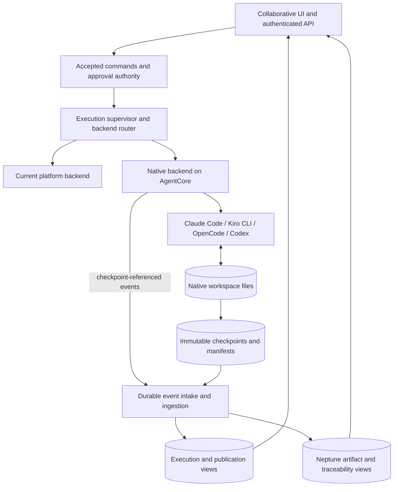

# Native AI-DLC execution implementation plan

Status: foundation implemented and bounded operator qualification in progress;
the native backend is not enabled for project execution.

Branch: `feat/native-aidlc-execution`.

Plan created: 18 September 2026.

Current sequence, selected on **29 September 2026**: the preparation timeout
repair is verified at **1143** on two fresh runs (98.968/101.093 seconds, no
invocation abort or recovery wait). Defer pre-provisioning and deliver native execution through
the **existing Intent UI and graph**. The [active delivery sequence](native-ui-first-slice.md#active-delivery-sequence)
defines five measurable steps: timeout verification; first real turn with
shared files/questions and graph links; protected answers/approvals; continuing
execution and recovery; all-four integrated acceptance. Earlier decisions and
the full P1–P10 requirements remain in force. A preparation-only page is not
the next feature acceptance result.

Earlier sequence, selected by the user on 24 September: **Kiro's bounded
interaction loop is verified; implement shared native UI next**. The user applied
the prompt-hash correction. Runtime **110 READY**, state **1118**, image tag
**`15c34685dcbc7627`**, actual source/CLI/EFS checks and **54 independent deployment
checks** passed. Computed runtime metadata remains 109; the control API and
running bytes identify 110.

Kiro completed the first question, title-only Blue Lake answer and next-question
loop. It explicitly loaded the same session and matched full retained user and
assistant replay hashes before the answer. Both turns acknowledged `auto`, exited
0 and confirmed cleanup. Only Q1 changed; Q2/scope confirmation stayed blank,
and native state/directive contents stayed unchanged. Parent and independent
two-turn reviews each passed **21/21**. The test session stopped with HTTP 200
at **06:56:50Z on 25 September**. No more deployment is needed for this correction.
See [the current checkpoint](native-interaction-probe.md#runtime-110--current-kiro-verification).

The [first shared UI slice](native-ui-first-slice.md) is a genuine native intent
start followed by durable publication of its first question/files to two members.
On 25 September the user selected per-run working-file isolation (D19), native
opt-in for new intents with the current backend staying default (D9), and
**flappy-bird** in **dev** for the pilot (D8). Approval recovery reuses only a
verifiably matching approval and otherwise requires fresh human confirmation.
No application turn timeout, token limit or spending cutoff is permitted.
Platform settings will control debug snapshot/conversation archives: off by
default, seven-day default retention when enabled, independently of required
recovery state for unfinished/resumable work. These decisions are recorded in
the first-slice plan; implementation remains unfinished.
The independent native answer/approval UI guards are implemented and locally
verified: 132 focused tests passed, followed by 18 affected tests after a fixture
typing correction, plus full frontend typechecking, lint and formatting.
The opt-in native draft/preparation UI is now verified through dev. State
**1140** includes automatic recovery from new-role validation, exercised by
fresh runs C and D; both reach READY and pass independent fresh-session EFS
checks. D's duplicate Create and full-allocation Prepare both retain its entire
record. The [preparation checkpoint](native-workspace-preparation-checkpoint.md)
records the live proof. Model start, durable publication and shared native
question/file viewing remain implementation work. Browser verification of
the earlier guards within platform/legacy intent views remains outstanding.
Authenticated nonmember reads of existing native intents and the draft
capability route now return 403, with details/forms absent. Native-page denial
handling also passes 48 related UI tests, including local stale-response
regressions; direct unauthorized writes and live revocation remain unqualified.

For the current delivery position and next observable milestones, see
[native delivery status](native-delivery-status.md). As of **28 September**, the
full native pilot remains incomplete. All four harnesses have scoped interaction
passes on their documented runtime versions: Kiro 110, Claude 108, Codex 107 and
OpenCode 106. This is not end-to-end four-harness acceptance. Shared native UI,
isolated approvals, execution checkpoints, project isolation and cold recovery
remain open. Kiro's `auto` is a routing mode, native directives use a `sessionless`
owner, and native startup/HUMAN_TURN bookkeeping is not protected human authority.

Current work: P1 local package materialization, provider-aware intake and D17
trust enforcement are implemented as internal services. A dedicated source
configuration API, default-off Terraform wiring and project-settings UI are
implemented; local UI tests, typechecking, and production build pass. The user
deployed the disabled foundation to `dev`; read-only infrastructure and
selected IAM-policy inspection passed. Source settings are now enabled in
`dev`; the first authenticated public-source save/list check passed.
One authenticated public package request and its worker authorization path have
been exercised. Remaining authorization/private-provider cases are pending.
The frontend runs locally against `dev`.
D18 reuses existing Neptune membership, with project/edge identity checks.
Initial P4 includes the bounded four-harness configuration probe and filesystem
evidence checks. Durable package publication and cold-cache recovery are now
implemented as internal services, connected to intake. The protected job store,
submission/status API and package-worker host are deployed and enabled in dev;
other environments retain default-off wiring. The corrected S3 policies passed
the bounded storage experiment. On 23 September, after a user-deployed Pipe
template correction, a normal authenticated UI import succeeded in one attempt.
Its receipt and six stored object versions match the independently verified
archive. A local Linux ARM64 experiment then verified the real package signature
and passed installation/configuration for all four harnesses. That
initialization experiment made no model call. See the
[package import checkpoint](native-package-import-checkpoint.md) and
[deployment verification](dev-native-plan-review.md#post-deployment-verification).
The [S3 policy documentation review](native-package-policy-review.md) was
completed on 21 September; public documentation access is no longer blocked.
Broader provider, IAM, retry and recovery qualification remains open.
Local G1 initialization passed. The dev-only operator
[interaction experiment](native-interaction-probe.md) is implemented and locally
checked. The user deployed its ECR-authentication recovery, and AgentCore runtime
103 and the remaining Lambda bundles were verified. The first real invocation
failed before model execution because native installation and project pinning
use hard-link locks unsupported on `/mnt/workspace`. Moving both to local disk
passed actual AgentCore initialization for all four harnesses (13 commands,
67 filesystem checks). D19 records the user's EFS working-directory direction,
with active harness stores kept local and EC2 excluded. Runtime 104 now mounts
EFS successfully; actual hard links and a 1 GiB + 8 MiB write/sync/readback pass.
Signed setup on EFS passes 13 commands and 67 checks across all four harnesses.
The mount-check and setup-timeout corrections were deployed and verified on
runtime **105**, state **1105**. Its first real Codex attempt passed four setup
commands and 18 filesystem checks, started the model and created a native
intent-questions file. It reached the 600-second deadline and ended with
`SIGKILL`; cleanup was incomplete because Codex/AI-DLC zombies remained under
PID 1. The failed session was stopped, and a fresh read-only session confirmed
the EFS artifacts persisted. No answer or approval was submitted.
At that checkpoint, first-question return and answer continuation were
unqualified. Cold recovery and project isolation remain open.

The bounded correction covers native PATH forwarding, a local Codex HOME
outside `/tmp`, Tini child reaping and omission of the sensitive native
steering-token key from snapshots. Its 116 focused tests and actual ARM64 image
checks passed, and the user applied the shell-reaper plan. Runtime **106 READY**,
state **1108**, image `59d8f47b...` and actual Tini/local-home/launcher/EFS source
and mount checks are verified. The prior plans are historical, not apply targets.
Codex returned its first title question and recorded **`X. Blue Lake`** in Q1
on the same native session; both turns exited 0 with confirmed cleanup. Q2–Q4
remain unanswered, and `request_user_input` was unsupported in exec mode, so
next-question delivery and full Codex qualification are not established.
The session was stopped with HTTP 200 at **10:20:50Z**. Kiro returned its title
question, recorded Blue Lake and returned Q2/Q3 through the same native file,
with both turns clean. Its changed session IDs and two JSONL logs leave
conversation-history resume unqualified; an `auto` model-selection
`MethodNotFound` warning also leaves model fidelity open. Kiro was stopped with
HTTP 200 at **10:48:49Z**. Claude passed setup but CLI 2.1.246 was rejected by API
400 requiring at least 2.1.255: exit 1, cleanup complete, no model response.
OpenCode passed setup and the scoped title-question/answer/follow-up loop:
Blue Lake is recorded in the native file, both turns are clean, and structured
events plus the native session file confirm the same conversation. Its runtime
session was stopped with HTTP 200 at **11:06:54Z**. Those four runtime-106
disposable sessions were stopped. Runtime-106 all-four live initialization
totals **16 commands/67 checks**; the earlier shared-install diagnostic used 13.

The [CLI compatibility plan](native-interaction-probe.md#cli-compatibility-deployment--applied-and-verified-historical)
was generated against state **1108** and applied by the user. The saved
`/tmp/aidlc-native-cli-compat-dev.tfplan` is historical, not an apply target.
Runtime **107 READY**, state **1111**, and image tag **`7020eeb9b852efb2`**
are verified. It includes both Codex question-tool overrides and Claude **2.1.257**,
the smallest published npm release meeting the required minimum. Ten actual
offline Codex checks, Claude integrity/config checks, 116 runtime tests, full
ARM64 image checks, Terraform validation and all 9 parent/23 independent plan
checks passed. The plan preserves IAM, EFS, networking and all 30 inputs.
Post-deployment review passed **25/25 checks**, including actual source hashes,
CLI versions, both Codex overrides, Tini, UID 1000, NFS and the four affected
Lambda code/environment comparisons. At that deployment, Terraform's computed
version and intents/environment-control `CORE_RUNTIME_VERSION` remained **106**;
the control API established version **107**. Kiro flags are unchanged. The
Claude/Codex results are recorded in the
[historical runtime-107 section](native-interaction-probe.md#runtime-107--historical-interaction-results).

The successful post-turn diagnostic measured **6.918 ms** for the login shell
versus **6,534.280 ms** for the bind hook, without session/pin metadata changes;
its cache/home were cleaned. This isolates hook-path overhead, not EFS causality.
The earlier module-loading failure produced no timing measurements. No storage
architecture change, human approval or cold recovery is claimed.
Current results and evidence are in the
[interaction checkpoint](native-interaction-probe.md) and
[EFS checkpoint](native-efs-probe-checkpoint.md), with current runtime-108 evidence
under `/tmp/aidlc-plan-tools/native-sessionend-applied-20260924/`, historical
runtime-107 evidence under `/tmp/aidlc-plan-tools/native-compat-live-20260924/`
and historical runtime-106 evidence under
`/tmp/aidlc-plan-tools/native-roundtrip-verify-20260924/`. Runtime-105 failure
evidence remains under `/tmp/aidlc-plan-tools/native-model-verify-20260924/`.
This package archive does not implement native execution-workspace
checkpoints or human-approval recovery.
D16's existing-repository migration is tracked
separately and does not block this work.

## Outcome and confirmed requirements

Add a native AI-DLC execution backend alongside the current platform backend.
Native AI-DLC reads and writes its normal filesystem artifacts, questions, state,
audit, and runtime records. Collaborative AI-DLC supervises execution, delivers
authenticated human actions, checkpoints files, and derives collaborative views.
It does not replace native file operations with mandatory graph-writing tools.

Confirmed by the user:

- Keep the native filesystem artifact model expected by core workflows.
- Develop on a new branch.
- Support **all four existing execution harnesses**: Claude Code, Kiro CLI,
  OpenCode, and Codex. A one-harness pilot is not the acceptance target.
- Pilot native files, shared viewing, questions/approvals, checkpoint recovery,
  and serial execution. Disable advanced edits and per-unit PR operations in
  both the UI and API until supported.
- Store accepted approval authority behind a permission boundary the runtime
  cannot write to. Existing project members may answer and approve gates.
- Let users select the AI-DLC repository and release in the UI, including a fork.
  Default to the highest stable release within that selected repository,
  resolving it to immutable package and source identities before execution
  starts. Publication dates do not take precedence over stable version numbers.
- Support public and private repositories, using existing source-control
  connections for authenticated access, across GitHub, GitLab, and Bitbucket.
- Use a separate read-only workflow-source binding configured by project
  owners/admins; members can select releases from it. Workflow sources do not
  become attached application code repositories or PR targets.
- Use subagents for bounded implementation and review work.
- Bring consequential decisions to the user.
- Handle local dependency installation, compilation and tests autonomously.
  The user explicitly authorized these actions; do not hand local validation
  back to them because an approval tool fails.
- Ping the user at useful deployment checkpoints; the user can deploy for
  verification.

The recommendations below are an implementation proposal. Items explicitly
marked **pending** are not permission to choose a default or enable a feature.
Implementation can proceed on independent prerequisites while decisions are open.

## Decisions and ownership

| ID  | Decision                                  | Status / recommendation                                                                                                                                                                                | Required before                                   |
| --- | ----------------------------------------- | ------------------------------------------------------------------------------------------------------------------------------------------------------------------------------------------------------ | ------------------------------------------------- |
| D1  | Harness coverage                          | **Decided:** all four existing harnesses                                                                                                                                                               | All work packages                                 |
| D2  | Pilot feature scope                       | **Decided:** native files, shared viewing/questions/approvals, checkpoint recovery, serial execution. Advanced edits and per-unit PRs excluded and disabled in UI and API                              | Pilot acceptance contract and UI exposure         |
| D3  | Approval authority boundary               | **Decided:** isolated authority store/permission boundary that the native runtime cannot write to                                                                                                      | Approval persistence and native runtime IAM       |
| D4  | Native upstream selection                 | **Decided:** UI-configurable repository and release, including forks; default to latest release. Resolve and pin immutable source/package identities before starting. Keep current backend independent | Package resolver and configuration UI             |
| D5  | Native human-response transport           | **Pending after adapter experiments:** use a supported harness response channel where it preserves native semantics; otherwise propose a narrow adapter into native hooks/tools for review             | Full question/approval implementation             |
| D6  | Approval permissions and granularity      | **Decided:** existing project members may answer/approve, matching today. **Pending:** multi-decision submissions, only if transport experiments require them                                          | Answer API and GateCard behavior                  |
| D7  | Missing protected session/challenge state | **Decided, 25 September:** reuse approval only when reliably matched to the restored step/content; otherwise re-present and require fresh human confirmation | Cold-resume acceptance |
| D8  | Test environment and repository           | **First native-intent pilot decided:** `flappy-bird` in existing `dev`, `us-east-1`; public `awslabs/aidlc-workflows` source verified live. Broader private-provider fixtures/credentials remain pending | First live verification |
| D9  | Enablement and default backend            | **Decided, 25 September:** native opt-in for new intents; current backend stays default; existing executions retain their backend | User-facing rollout |
| D10 | Resource limits and retention             | **Decided, 25 September:** no application turn timeout, token limit or spending cutoff; preserve serial execution. Platform debug archive settings default off, retention defaults to 7 days when enabled. Required recovery state is independent of debug settings/retention | Native execution policy and retention implementation |
| D11 | Private forks and repository providers    | **Decided:** public and private repositories on GitHub, GitLab, and Bitbucket through existing source-control connections. Release-format adapters must be qualified for each host.                    | Package authentication and release discovery      |
| D12 | Workflow-source binding                   | **Decided:** separate owner/admin-configured read-only source binding; members select releases. Keep it separate from attached application code repositories.                                          | Private-source authorization and configuration UI |
| D19 | Active native workspace filesystem        | **Direction and isolation decided; qualification pending:** AgentCore microVMs, local harness executables/active stores, EFS native installation/workflow/code. Each run's working files are isolated from all other runs, including within a project. Shared published artifacts remain available through the application. EC2/Instances excluded. Qualify scoped EFS/runtime permissions, one-writer ownership and consistent harness-state export/restore. See [storage assessment](native-storage-options.md). | EFS workspace qualification and native recovery implementation |

Additional release decisions:

- **D13 — decided:** latest is the highest stable `vX.Y.Z` in the selected
  source's currently published release inventory, never across sources.
  If both exist, choose `v2.9.0` over a later-published `v2.8.4`. Do not
  substitute arbitrary Git tags or cached historical packages for that
  source's release inventory.
- **D14 — simplified following user feedback:** allow Bitbucket publishers to
  overwrite the current published package **if the prebuilt-package path is
  used**. Do not require version/commit
  filename prefixes or a historical release bundle collection. The application
  must capture verified immutable bytes before starting a run. Older releases
  that are no longer published and were never imported are unavailable.
  Package retention/cleanup remains D10; overwriting provider files must never
  replace a package referenced by an active or resumable execution.
- **D15 — decided:** keep prebuilt packages as the primary input. The user
  selected this after reviewing the alternative of generating/building from
  a pinned Git commit. Git still preserves framework source; generated release
  files and the installed native binary are separate. A source-build path is
  a possible later option, not a prerequisite for the prebuilt pilot or an
  automatic fallback when a package is missing. Source-only forks need a
  compatible package for the primary path; their Git history is not lost.

**D16 — decided, 18 September 2026:** track the existing application-repository
access migration as a
[separate follow-up](existing-repository-access-follow-up.md).
It is outside this native execution milestone and is not an open decision
blocking this plan. Any requirement for existing project owners/admins to
confirm access again must be agreed in that follow-up. New native workflow
sources retain mandatory connection fingerprints.

**D17 — decided, 18 September 2026:** trust workflow sources explicitly configured
by project owners/admins. Pin the selected version and exact bytes, enforce
checksums and current source access, and verify build signatures when available.
Missing signatures do not block a fork under platform policy. Failed signature
verification is not treated as an unsigned package. Checksums/source access
do not themselves prove how a binary was built. Native installer compatibility
and harness qualification remain independent requirements; no execution route
is enabled merely by recording this decision.

**D18 — decided, 18 September 2026:** reuse existing project membership for now.
The current users API stores and reads roles on Neptune `HAS_MEMBER` edges,
rather than in DynamoDB. Do not add a roster migration, new membership authority
table, or platform-admin confirmation step. Keep the approval records and
workflow-source bindings isolated from runtime writes. Because the runtime can
write the graph, this does not isolate the membership information used to
authorize a person; that existing limitation is retained for the pilot.
Membership hardening is deferred separately from D16's OAuth migration.
Use existing membership-edge and project-vertex identities to detect normal
removal/readdition and project recreation; these checks do not protect against
an actor capable of rewriting those graph identities.

Implementation choices that do not alter these product decisions—module
boundaries, test helpers, naming, or retry implementation details—can be resolved
within a work package and reviewed with its patch.

Every decision record should include the selected option, date, constraints, and
affected work packages. A changed decision updates this plan and its tests; it
does not silently change an active execution.

## Architecture and invariants



1. One backend and one workflow owner per execution. The native engine owns
   methodology routing; the supervisor owns worker liveness and delivery.
2. Native files are canonical artifact content. The graph is a projection.
   Capture raw content before attempting typed extraction.
3. Accepted human actions are distinct from native application of those actions.
   A callback or CLI exit code alone proves neither approval nor application.
4. Pin the package, harness, configuration, environment, adapter, and source
   revisions. Never resolve `latest` during a running execution.
5. Resume from the last acknowledged durable checkpoint. Document the possible
   loss of uncheckpointed work.
6. Reject late writes from retired execution attempts. Do not replay ambiguous
   external side effects automatically.
7. Unknown artifacts remain readable. Unknown control directives stop with a
   compatibility error.
8. “Serial construction” limits concurrent units. It must not flatten native
   `pipeline`, `mob`, reviewer, or delegated-agent semantics inside a stage.
9. A request to use an unavailable native capability fails explicitly. There is
   no silent fallback to the platform backend.
10. Keep genuine human answers separate from automated continuation and steering.
    UI selections must not be represented as typed override phrases.

## Work packages and dependency order

Each work package is a reviewable patch or small patch series on the branch.
“Done” requires its stated checks and updates to the execution log below.

```text
P0 Prerequisites and decisions
 ├─ P1 Immutable native packages and fixtures
 ├─ P2 Backend identity and capability contracts
 └─ P3 Approval authority design (after D3)

P1 + P2 → P4 Four harness adapters and interaction experiments
P1 + P2 → P5 Checkpoint publication and ingestion
P3 + P4 → P6 Accepted human actions and native delivery
P4 + P5 + P6 → P7 Durable supervision and recovery
P2 + P5 + P6 → P8 Collaborative UI
P4 + P5 + P6 + P7 + P8 → P9 Live qualification on all four harnesses
P9 → P10 Controlled rollout and subsequent capabilities
```

### P0 — prerequisites and review baseline

Current patch:

- [x] Create `feat/native-aidlc-execution`.
- [x] Record the implementation plan and deployment checkpoints.
- [x] Fix `/ping` to omit the optional `time_of_last_update` field. AgentCore
      should observe real status transitions, not a new activity timestamp on every
      health request.
- [x] Cover repeated idle pings, overlapping background work, return to idle,
      and unchanged invocation timestamps.
- [x] Run focused HTTP and background-stage tests: **39 passed**.
- [x] Record D1–D4 and project-member approval policy.
- [ ] Resolve transport/recovery decisions from experiments before dependent work.

Changed production module: `lambda/agentcore/http-server.js`.

Validation: `lambda/agentcore/test/http-server.test.js` and
`lambda/agentcore/test/run-stage-start.test.js`.

The first test invocation was blocked by sandbox restrictions on localhost
listeners. Both suites passed after granting local socket access. No code change
was needed for that environment limitation.

### P1 — pinned workflow sources, materialization, and fixtures

Depends on: D4 (confirmed).

**Correction after the repository-files clarification:** versioned AI-DLC source
files, generated/installable framework files, and a running workspace's state
are different things. The source repository contains `core/`, `harness/`,
plugins and build tooling. In the inspected upstream snapshot
`c8262851e50252865bb8882b43769a3348c9ec49`, the README and
`docs/guide/18-install-and-lifecycle.md` document cloning the repository,
`bun install --frozen-lockfile`, and `bun scripts/package.ts`. This generates
`dist/<harness>/` and `dist-release/<harness>/`; those output directories are
not committed upstream.

Therefore, a pinned source commit can supply an older workflow version even
when old release downloads are gone, provided the commit and required build
inputs remain available. The earlier claim that such a version is unavailable
applies only to retrieving the exact prebuilt release bytes, not to rebuilding
the framework from Git. Source checkout alone is not the installation step:
we must generate the harness files or build the native CLI as appropriate.
Pin the toolchain/dependencies and run fork build code in an isolated worker
without source credentials or approval authority.

The user subsequently chose prebuilt packages as the primary input (D15).
Continue the package intake path below; a source-build experiment is not
required before provider-specific downloads. The existing verifier's tests do
not qualify a source build. If that option is added later, qualify it across
all four harnesses and explicitly define whether source tags constitute version
publication. Keep source commit, optional build inputs, installed-files digest
and execution checkpoint as distinct identifiers.

For a running execution, pin the selected source and checkpoint its actual
workspace, including installed framework files and relevant generated state.
If those framework files are committed into the application repository, its
commit already preserves their tracked content. Recovery still needs
uncommitted/gitignored session state where core workflows require it.
Any internal generated-package cache supports installation and recovery; an
indefinite archive of every external release is not an inherent requirement.

Offline verification foundation implemented:

- `lambda/shared/native-release-selection.js` implements the source-scoped
  highest-stable-version policy over normalized published-release candidates.
  Latest selection requires complete discovery, excludes drafts/prereleases,
  and happens before compatibility checks. Explicit tags may select a
  published, non-draft prerelease using the supported native tag grammar.
  This module does not fetch provider data or produce a commit/package pin.
  **103 focused tests passed**, covering semantic ordering, complete discovery,
  source isolation, exact overrides and sanitized results.
- `lambda/shared/native-release-manifest.js` validates schema-1 release
  metadata, exact source/release pins, checksum consistency, the selected
  binary/runtime, and the four required harnesses.
- `lambda/shared/native-runtime-package.js` verifies the actual asset bytes,
  rejects links, unsafe paths, conflicting entries and oversized archives,
  checks the four projection layouts, and produces a repeatable package ID.
- `scripts/verify-native-release.mjs` exposes this as an operator command.
  Run `node scripts/verify-native-release.mjs --help` for its required inputs.
  It reads an already-downloaded release directory and executes none of its
  contents.
- Source pinning checks an independently supplied commit; this command does
  not itself resolve the release tag or authenticate its publisher. Its report
  marks attestation and live harness execution as **not verified**.
- The current metadata adapter accepts the native stable/preview version and
  tag protocol. A fork with different packaging/tag semantics fails explicitly
  until an adapter is qualified.
- **213 focused tests passed** against authored package fixtures, including the
  operator command. The actual selected release assets still need verification.

Filesystem materialization foundation:

- `lambda/agentcore/native/package-loader.js` accepts the complete confirmed
  verifier report and a separate SHA-256/size pin for the original
  `aidlc-release.intoto.jsonl`, or explicit `null` when absent. The sidecar is
  outside upstream's checksum inventory, so its digest (or pinned absence)
  participates in a separate materialization identity.
  The existing package ID remains the identity of the binary, runtime and
  release metadata.
- Copy the four core files and any pinned sidecar into a private staging directory, bound and hash
  the bytes while copying, reverify the staged release, then publish atomically.
  Preserve the complete runtime archive, including plugin content. This code
  does not extract or synthesize harness configuration.
- Reverify every cache hit. The original download is unnecessary for a valid
  cache hit; a changed source publication cannot update an existing run's pin.
  Missing/corrupt/unexpected cached files fail instead of triggering an overwrite.
- A per-materialization publication lock protects cooperating loaders.
  Contention can return `native_package_busy` for a retry with the same pin.
  Crashed-publisher staging/locks require later supervised cleanup; they are
  never automatically stolen. This is an ephemeral local cache, not durable
  package storage or a checkpoint implementation.
- The caller must authorize cache access and place it outside agent-controlled
  workspace paths. File modes are not isolation from code running as the same
  operating-system user. Private project scoping and IAM remain intake/runtime
  integration requirements.
- `tar-stream` is now an explicit AgentCore production dependency because
  materialization imports the shared archive verifier.
- **73 filesystem and injected-I/O tests passed**, covering source replacement,
  loss of the original download, all five cached-file roles, pin changes,
  concurrent publishers, busy retries before any source reads, FIFO/symlink
  rejection, interrupted writes and cleanup failures. These fixtures do not
  execute an AI-DLC binary or authenticate a real provenance bundle.

Provider intake foundation:

- `lambda/shared/native-release-catalog.js` discovers the selected source's
  complete published inventory with generated, source-scoped pagination.
  It selects the highest stable release before checking its assets, resolves
  the exact tag to a commit, and requires the four core native package files.
  A listed attestation sidecar is validated and pinned; absence is explicit.
  A malformed listed sidecar fails instead of being treated as unsigned.
  GitHub annotated tags have depth/cycle limits. GitLab requires the permanent
  download route for the selected project/tag. Bitbucket's current Downloads
  manifest supplies its sole rolling release candidate; historical Git tags
  do not become available packages.
- `lambda/shared/native-source-transport.js` permits only closed read routes
  for that source. It never authenticates a foreign repository or arbitrary
  release URL. Asset redirects use an explicit delivery-origin allowlist and
  lose authorization headers, including on same-origin hops. Metadata redirects
  fail. Request counts, deadlines and streamed byte limits bound acquisition.
  Truncated unencoded HTTP bodies fail; decoded compressed bodies retain their
  byte limits. Timeouts cancel active readers and dispose late responses.
- `lambda/shared/native-package-intake.js` connects authorization, credential
  resolution, discovery, downloads, metadata/byte verification and materialization.
  It rechecks publication identity and small metadata files after acquisition,
  plus binding revision, membership and credential authority around publication.
  The result contains pins without tokens, signed URLs, credential references
  or local filesystem paths.
- Cache directories are scoped to both project and workflow source. Loading a
  trusted existing resolution rechecks access and its bytes without discovering
  latest or fetching a replacement. Known publication contention remains a
  retryable `native_package_busy`; failures remove only the intake's own staging.
- `loadForExecution` additionally applies `native-package-trust.js` to a fresh
  materialization and current owner/admin-configured binding. An absent sidecar
  is explicit; malformed, failed or unavailable present-signature verification
  never becomes unsigned acceptance. Authorization is checked again after
  verification and after awaited credential resolution. Plain returned trust
  evidence is not an authority token.
- `lambda/agentcore/native/github-signature-verifier.js` uses a trusted `gh`
  executable against privately snapshotted checksums and proof, enforcing the
  repository, signer workflow, source ref and source commit. It receives no
  ambient credentials. This adapter covers GitHub provenance only; other
  present signature formats require a qualified adapter and currently fail.
  Local command-contract tests are not cryptographic qualification. The runtime
  image still needs the verifier dependency and a real-bundle smoke test.
- Explicit `authType: public` source bindings use anonymous repository probes
  and no credential references or delegation. Public resolution yields
  `token: null`; missing private credentials never trigger an anonymous fallback.
  Configuration/removal still requires an owner/admin, and release access still
  requires project membership.
- These are broker domain modules, with injected source authorization and
  private storage roots. The dedicated source configuration API is implemented
  behind a default-off flag. Durable package storage is implemented behind an
  internal archive port; the protected worker and job infrastructure are wired
  with activation blocked pending publisher policy and host qualification.
  A deployed installer and native execution route are not implemented. D18 deliberately reuses
  existing Neptune membership; there is no separate membership authority store.
  Provider HTTP tests use simulated responses. Actual GitLab private-download
  behavior and all redirect destinations still need live qualification; unknown
  origins and opaque pagination cursors fail until an adapter is reviewed.

The pinned upstream snapshot's offline installation contract was checked in
`core/tools/aidlc-release.ts`, `aidlc-lifecycle.ts`, `aidlc.ts`, and the lifecycle
guide. The public compiled-CLI route on a fresh isolated installation root is:

```sh
<release>/aidlc-linux-arm64 use <version> --from <release> --offline --json
```

Set `AIDLC_INSTALL_ROOT` and `AIDLC_BIN_DIR` independently per immutable
materialization; upstream reuses an existing installation by version. Then
use the native `config` command for project pinning and harness selection,
letting core own extraction, hook merging and installation metadata.
There is no public top-level `install --from` command in this snapshot.

The local installer requires the attestation sidecar even without a shell
wrapper, but cryptographic verification may be skipped when a capable `gh`
is absent. Therefore a successful installer exit is not proof of provenance.
The loader preserves and verifies any sidecar's pinned bytes; it deliberately
keeps `attestation` and `harnessExecution` as `not-verified`. Apply the D17 trust
policy before executing package code. An unsigned package may pass that policy
and still fail this native installer's separate compatibility contract. Never
fabricate a bundle or hide an installed verifier to make it pass.
Do not assume that a non-GitHub fork
shares upstream's GitHub signer identity; qualify each source's provenance
contract as part of intake. The exact selected binary and public command
contract still need live verification.

The current source-control binding service only accesses repositories attached
as application code and requires write authority during setup. It cannot simply
be reused for arbitrary read-only workflow sources without changing that
permission model. D11/D12 now require all three providers and a separate
read-only binding. Provider credentials stay inside package intake; the native
runtime receives verified package bytes. OAuth connections may have broader
scopes, so read-only operations must also be enforced in that service.
The new transport can fetch package bytes when invoked by a protected broker;
no application route, registry publication, workspace install or native
activation is enabled by this foundation.

Private-source domain foundation implemented:

- `lambda/shared/workflow-source-bindings.js` uses a separate table contract
  (`WORKFLOW_SOURCE_BINDINGS_TABLE`) and explicit field allowlists. It never
  falls back to the application binding table or persists tokens/SSM paths.
- `lambda/shared/workflow-source-service.js` restricts configuration/removal
  to project owners/admins, permits member reads, and rechecks administrator
  membership after provider verification. Every update/removal requires the
  revision the caller viewed. Package selection also checks the OAuth
  delegator's current membership.
- OAuth bindings retain a digest of the connection's provider, owner, token
  parameter path, creation time and generation. A reconnect requires explicit
  verification even for the same user and timestamp. Neither the parameter
  path nor digest is exposed in the source view.
- Git connection reads are consistent; disconnect leaves a credential-free
  tombstone, and legacy migration checks both rows in one transaction. All
  explicit connection writes require an observed snapshot. Refresh updates
  only metadata and rejects changes to connection identity before/after token
  persistence. New connections use unique token parameter paths.
- Deletion retains a credential-free tombstone with a fresh revision, preventing
  a pending create from resurrecting a source that another administrator has
  created and removed. A later explicit configuration verifies again and
  conditions its write against that tombstone.
- `verifyReadOnlySourceCredential` and `resolveReadOnlySourceCredential` support
  all three OAuth providers plus GitHub App repository-read tokens. Their probe
  checks one page, rejects redirects, validates JSON, and permits only one
  refresh retry under a 10-second deadline. Application write requirements are
  preserved; workflow-source bindings cannot use the application resolver.
- **66 focused tests passed** for the separate store, service, and integration
  with the credential helper, alongside 41 connection-identity tests and 108
  credential-helper tests. These use AWS/provider mocks; they do not verify
  deployed IAM or live private-source access.

**Dedicated source API foundation:** `lambda/workflow-sources` now exposes
Cognito-authenticated list/configure/remove routes through a dedicated Lambda.
The handler accepts a closed request schema, takes the acting user only from
gateway claims, enforces body/identity limits and maps known failures to fixed
safe responses. It has no internal operation dispatch, credential retrieval
endpoint, package execution route or function URL. It rejects client-supplied
credential references and actor identities. The domain service still enforces
membership/roles and conditional revisions; the handler does not independently
authenticate a copied JWT-claims object.

Terraform now defines an isolated workflow-source table and role, the dedicated
API Gateway routes and narrowly scoped invoke permissions. The runtime and
existing agent-callable Lambdas do not receive invocation or table access.
The source service has Neptune read access and the narrowly scoped credential
refresh/migration permissions needed by existing connection helpers.
`enable_native_workflow_sources` defaults to false and enables only source
configuration. It does not enable the native backend.

The Agent settings tab now lists workflow sources for members and lets
owners/admins configure, reverify and remove public/private sources on all three
Git hosts. OAuth uses the user's existing connection, with an explicit read
delegation checkbox. Reverification and removal submit the observed revision;
conflicts require a reload and are never silently retried against a newer row.
Project changes invalidate pending UI responses. The section stays hidden for
the explicit disabled-API response. Members now have package import controls
for latest stable or an explicit version, job status, and a narrow package
preview. An immutable request is retained per user/project/source/revision for
GET recovery after a lost response or component remount. No automatic retry
chooses a new `latest`. Clearing a saved request is explicit and does not cancel
an existing worker; stale queued polls are invalidated before clearing.
Disabled-import responses leave source administration available. All frontend
tests, full typechecking, and the production build now pass; browser interaction
and deployed integration remain unverified.

The new private, versioned native-package S3 bucket is deliberately separate
from the runtime-readable artifacts bucket. It has public access blocked,
TLS-only access and encryption, no runtime grants and no automatic
expiry of potentially referenced packages. The conditional write grant is now
wired only to the dedicated package worker, and the bucket denies other publishers.
It has not been deployed or used by
a production archive worker. The internal archive implementation is described
below.

**Durable package archive foundation:**

- `native-package-pin.js` shares the loader's exact schema-1 identity and file
  allowlist with storage. Extracting it does not change existing package or
  materialization IDs. It snapshots pin/proof inputs and rejects malformed
  sources, versions, hashes and file sizes before storage access.
- `native-package-archive.js` generates keys from the canonical project/source
  scope hash and materialization ID. It privately snapshots and verifies the
  four original release files plus an optional proof. It performs sequential
  checksum-bearing conditional uploads and writes a canonical manifest only
  after all files have stored versions. The manifest contains the exact file
  names, digests, byte counts and non-null S3 VersionIds.
- Successful publication returns a receipt pinning the manifest's own VersionId,
  hash and size. It contains no bucket name, URL, credential reference or local
  path. `native-package-intake.js` stores it as `resolution.archiveReceipt`.
  The receipt identifies bytes; it is neither current authorization nor evidence
  that signature verification or native execution succeeded.
- With an archive configured, `prepare` returns only after publication and a
  final authorization check. A missing/malformed receipt is rejected even for a
  warm-cache load. Host callbacks reauthorize before the manifest commit and
  before restored files are published locally. Intake also reauthorizes around
  the complete operations. Revocation after a commit withholds the resolution;
  already-written private objects are retained, not treated as permission.
- The local loader now distinguishes a genuinely absent entry with
  `native_package_not_cached`. Only that outcome permits archive restore.
  Corruption, missing files inside an existing entry, a busy publisher and I/O
  failure never trigger replacement. A restore reads the exact manifest version
  from the receipt and the exact file versions from that manifest, checks their
  sizes/digests, then runs the actual filesystem materializer again. It does not
  query the provider, resolve `latest`, or substitute another S3 version.
- Conditional-write conflicts do not overwrite files. Existing objects are read
  and hashed before reuse. A lost upload acknowledgment remains an ambiguous
  storage failure; retrying the same publication can recover the already-written
  versions and commit without replacement. There is no automatic remote delete,
  package expiry, adoption of an unrelated commit or repair of corrupt bytes.
- `recoverReceipt` closes the crash window between the S3 commit and saving its
  receipt. Given the original candidate pin, it reads that materialization's
  fixed commit key, checks scope/pin identity, and hashes every exact file
  version before returning the recovered receipt. It writes nothing and does
  not assemble partial uploads into a new commit. Intake's
  `recoverPreparation` adds current source authorization before/after this
  reconciliation and returns only the original package identity and receipt.
  A lost worker filesystem or overwritten upstream release does not prevent
  recovery of an already-committed package.
  Reconciliation rejects a candidate that already has a saved receipt; that
  candidate must continue using exact-version restore. It cannot replace a
  failed original receipt with a different current commit.
- SDK requests and response bodies have bounded waits and byte counts.
  Timeouts abort requests and dispose late bodies; only owned local staging is
  removed. Trusted filesystem roots must use canonical absolute paths and have
  safe ancestors. File reads reject observed symlinks/non-regular files.
  Intake completes successful source-staging cleanup before its final
  authorization check, so revocation while cleanup is waiting cannot produce a
  prepared resolution.

**Archive host prerequisites:** inject the dedicated versioned bucket and
expected account owner through trusted configuration; create canonical private
working roots; and always supply the archive port for durable/native use.
Keep all archive access in a protected worker. Its IAM should contain only
prefix-scoped `PutObject`, `GetObject`, and `GetObjectVersion` as needed.
Runtime, source-administration API and ordinary orchestrator roles receive no
bucket access. The existing 512 MiB/30-second source API is not a package worker:
the package limits alone allow a 256 MiB binary plus a 128 MiB runtime archive,
before verification and staging overhead.

Before granting a production publisher, qualify bucket-level create-only and
deletion protections, including alternate upload/copy APIs. The current bucket
policy enforces TLS and has no application writer grant; it does not yet enforce
conditional uploads. Do not claim versioning alone prevents privileged
overwrites/deletion. No automatic cleanup is added ahead of D10's retention
decision. Missing-object responses without listing permission can be ambiguous;
an access-denied response must not be interpreted as proof that a package is
absent.

The job host must durably record the original candidate pin, selected source,
binding revision and requested release before publication, and reconcile that
candidate after an ambiguous failure. Starting fresh `latest` discovery is not
a retry of the original publication. The host can journal the trusted
materialization received by its archive adapter before forwarding `publish`;
that adapter must await the durable job write. A recovered receipt must also be
conditionally recorded in that same job before completion is exposed.
The protected DynamoDB job store and worker now implement this journal, fenced
leases, idempotent submission, exact candidate/receipt recovery, and an overall
attempt budget. The dedicated source API provides submission and status routes;
its role grants `PutItem`/`GetItem`, while the worker grants
`UpdateItem`/`GetItem`. Create-only submission, existing-row updates, and field
ownership are enforced by trusted application conditions. Those IAM actions
alone do not prevent the source API from replacing job state or the worker
from upserting rows if compromised. The isolated tables protect these records
from agent runtimes, not from either trusted control service.
DynamoDB Stream → EventBridge Pipe → SQS wiring avoids an API table/queue dual
write. Schema validation, publisher policy wiring, and disabled deployment are
complete; live dispatch and request enforcement remain open, so activation is
blocked. There is no reconciliation sweeper
for dispatch outages beyond stream retention; the checkpoint documents operator
replay of pointers to existing nonterminal jobs. No agent may submit work
directly to these new protected functions or access their isolated storage.

**Activation prerequisites:** the disabled foundation is deployed but not
qualified for live imports. The current AgentCore role can invoke
the existing source-control Lambda
(`terraform/modules/compute/agentcore/main.tf`); adding administration routes
to that mixed HTTP/internal handler would let an agent submit API-shaped
claims. Use a separate function the runtime cannot invoke, with read-only
membership lookup permissions and access only to workflow-source storage.
Following D18, the membership lookup uses the existing Neptune relationships.
The runtime has cluster-wide Neptune write/delete permissions, so the API's
separate IAM boundary does not make those membership facts immutable. That is
a retained pilot limitation, not a requirement for a new membership migration
before this API can be qualified.
Production source authorization now captures the existing project vertex and
OAuth delegator membership-edge identities. It rechecks the administrator
after provider verification and compares source pins with current memberships
on use; ordinary removal/readdition and project recreation require explicit
reverification. Missing identity pins on old rows cannot authorize package
access through the production service. Ambiguous graph matches fail closed.
Live connection identity checks prevent disconnected/reconnected credentials
from reviving a binding. Package intake compares both graph identities around
credential resolution, publication and cache loads. These are separate reads
across Neptune and DynamoDB, not an atomic authorization transaction.
Any later cleanup/status invalidation must condition on the inspected source
revision so delayed work cannot overwrite a newly verified binding.

The previous GitLab/Bitbucket refresh path unconditionally restored connection
metadata after writing SSM. The guarded store and shared refresh coordinator
now prevent that restoration, including the personal provider API's 401 retry
path. Tests pause disconnect/reconnect between provider response, SSM write and
metadata write. The Git and tracker disconnect APIs revoke authority before
token cleanup and return a conflict when a newer connection wins. Failed
callback publication rechecks the live connection before cleanup. A successful
write followed by an SDK retry's conditional failure recovers as success when
the current row identifies that callback's token. Failed recovery reads retain
the token rather than risk deleting published credentials.

Application bindings now receive a fresh revision when written. Delayed
invalidation conditions on the inspected revision (or legacy snapshot).
Refresh/status invalidation also checks connection identity in the same
transaction. Disconnect captures binding revisions before revoking its viewed
connection, then invalidates those captured revisions. Thus an unchanged
observed grant is revoked even after reconnect, while a newly verified binding
is preserved. The full application-delegation migration is tracked in the
[separate D16 follow-up](existing-repository-access-follow-up.md): an eventually
consistent index can miss dependencies, and pending verification needs an
identity guard. That migration does not block this milestone. Native workflow
source lifecycle checks have been implemented independently and still require
live qualification.

This does not revoke a token already issued to an external operation. A late
refresh can also recreate unreferenced bytes at its old parameter path; it
cannot publish that path as an active connection. Add bounded orphan-parameter
cleanup before operational rollout. Do not delete/reuse tombstones without a
separate durable generation fence.

Deployment must update every credential writer and drain invocations running
the old unconditional writer before private native-source activation. Old
Lambda code is not constrained by the new condition expressions. The
credential broker now needs `DeleteItem` on the legacy connection table for
atomic migration; the Terraform change grants this only on that table.
GitHub/GitLab/Bitbucket connectors also require `ConditionCheckItem` on the
provider connection table; the GitHub connector needs `UpdateItem` on the
application binding table and the previously missing binding-table environment
variable. The added grants are scoped to those tables and still need deployed
verification. The source service now supplies the complementary project and
membership-identity checks; deployed remove/re-add and reconnect scenarios
still need verification.

The dedicated API should expose source list/configure/remove operations only
to authenticated project users with the roles above. Configuration accepts
provider, repository identity, authentication type, explicit OAuth delegation,
and expected revision; credential references and tokens are never client
inputs or response fields. The package broker gets a separate closed set of
read operations (list releases, resolve release, fetch verified assets), with
no generic provider operation or arbitrary URL proxy. Public source resolution
uses anonymous provider access and must never fall back to another project's
private binding.

For the primary prebuilt path, Bitbucket can use a rolling publication: its current `version.json`,
`checksums.txt`, selected binary, and runtime archive identify the package
available for import. The runtime archive keeps its native manifest filename;
publishers may remove superseded files. No filename prefix is required.
Only the current publication manifest contributes a release candidate; leftover
archives, historical Git tags and cached packages do not. If the sole current
publication is a preview, there may be no latest stable release available.
Resolve the manifest's exact release tag to a commit independently, verify all
selected bytes, and publish the internal package atomically only after the
complete verification succeeds. A source overwrite during download can yield
mixed or missing files: retry within a fixed budget or report that publication
changed; never start from a partial package or silently select an older release.
Retries must preserve the confirmed version, commit and package digests.
A coherent replacement with valid checksums is still a changed selection:
return its new resolution for confirmation instead of silently starting it.
Document and verify Bitbucket's actual replacement/download API behavior with
public and private fixtures before wiring that adapter.

For the prebuilt path, provider-side history is optional. Internally, retain at least the packages
referenced by active/resumable executions, so a run started on one workflow
version does not change methodology after a wait or restart. An older version
that was never imported cannot be reconstructed from a tag alone: the tag
identifies source code, not necessarily the same compiled binary and generated
runtime bytes. The UI must report unavailable versions explicitly. Garbage
collection of unreferenced packages belongs to the D10 retention decision;
this does not impose indefinite storage of every release. The source-based
path described above may reconstruct a version from its commit; it is not
subject to the same requirement to retrieve the original published binary.

Tasks:

1. Add repository and release selection to the native configuration UI.
   Default to the highest stable release of the configured repository; allow
   explicit releases and forks. Show the resolved repository, tag, commit, asset
   digest, and compatibility result before start. Re-resolve floating selections
   at start and present a changed resolution for confirmation; never update a
   running execution automatically. Order versions numerically, not by tag
   text, publication timestamp, or the host's latest-release designation.
   Finish release discovery before choosing a maximum; do not choose from an
   incomplete first page. Select the highest stable candidate before checking
   package compatibility, then report failures without silently falling back.
   An explicit release override may select a published, non-draft prerelease
   with supported native packaging; show its prerelease status in the UI.
2. Resolve the selected release to an immutable source commit, Linux ARM64
   runtime asset, checksum, and provenance record. A fork must pass the same
   package/protocol qualification as upstream. Unsupported packaging produces
   an actionable compatibility error, not a fallback to upstream. Keep repository
   credentials separate from provider/model credentials; do not embed tokens in
   source URLs, manifests, or logs.
   Resolve private repositories with their existing source-control connection.
   Authorize every lookup/cache read, scope private packages to the owning
   project/tenant, and validate release-asset destinations before following
   redirects. Never forward repository credentials to an unrelated asset host.
   D15 confirms this prebuilt path as primary. If source builds are added later,
   resolve and fetch the commit, pin build inputs, generate/install in an
   isolated worker and record the resulting files' digest. Do not silently
   switch to executing fork build scripts when a selected package is missing.
3. Keep native distributions independent of `seed-blocks`. New native versions
   must not replace the current backend's SYSTEM blocks.
4. Store immutable package manifests keyed by package identity/digest; publish
   a separate pointer for defaults. Reuse S3 and environment registry patterns
   where appropriate. The pointer accelerates lookup; it must not override
   current source discovery or D13's version-ordering policy.
5. Install a complete supported runtime projection for each of the four
   harnesses. Do not fetch generated `dist/<harness>/` paths from a source
   archive that does not contain them.
6. Preserve native hook configuration and built-in tools; explicitly merge
   platform credential/model configuration without losing native behavior.
7. Record the effective graph, plugin list, custom configuration hashes, and
   runtime compatibility capabilities.
8. Create small version-pinned fixtures for workspace creation, ordinary
   questions, protected Plan Approval, reviewer receipts, and final completion.
9. Inventory recovery files that Git excludes, including native session/challenge
   records. A source checkout alone is not a sufficient recovery fixture.

Likely files:

- New `lambda/shared/native-runtime-package.js` and tests.
- New `lambda/agentcore/native/package-loader.js` and tests.
- `lambda/agentcore/Dockerfile`.
- `terraform/modules/compute/agentcore/` and managed-environment composition.
- Existing `lambda/intents/native-export.js` and
  `lambda/shared/distribution-archive.js` are reuse candidates, not automatic
  production dependencies on the export flow.

Acceptance:

- All four package projections load and report their exact versions.
- Missing or corrupt assets fail before an agent launches.
- A second published native package leaves an existing execution's package
  unchanged.
- Package/hook tests run from the exact distributed artifact, not only a source
  checkout.
- Latest-release changes, moved tags, missing assets, and an incompatible fork
  cannot change the package for an existing execution.
- Release selection is usable from the UI; a fork with the supported protocol
  works without a deployment configuration change.
- A private fork can resolve, install and resume using the authorized connection;
  another project cannot retrieve its cached package without its own access.

### P2 — backend identity, API routing, and capabilities

First foundation implemented on this branch:

- Explicit identity on new execution records; absent legacy identity means
  `platform`, while an unknown or null identity never enables platform mutations.
- API DTO capability contract, guarded mutation routes, and defensive platform
  orchestrator/Quorum/maintenance checks.
- Native creation/start and backend switching fail explicitly. No native
  execution or configuration selector is enabled by this patch.
- HTTP boundary, process-store, orchestrator, stage-skip and durable replay
  checks: **283 tests passed**, plus **24 frontend capability-helper tests**.

Remaining work below includes native routing and pinned configuration. The
foundation is not completion of P2 or qualification of a native runtime.

Tasks:

1. Define `executionBackend: platform | native`; absence on an old record means
   `platform`. Reject invalid explicit values.
2. Pin backend selection when execution starts. Define draft editing separately;
   prohibit changes on an active or previously started execution.
3. Add an immutable native execution configuration with package digest, harness
   version, environment revision, repository revisions, configuration hashes,
   and adapter/protocol versions.
4. Introduce a shared backend boundary for start, answer, cancel, inspect,
   recover, and capability queries. Keep native methodology routing out of the
   platform plan compiler.
5. Add server-side capability checks for every mutation route, including edits,
   rewind, reshape, feedback, export, and per-unit PR operations. Hiding a button
   is insufficient.
6. Keep the native backend unavailable until its qualification flag is enabled.
   An explicit request for it must not launch a platform execution.
7. Use distinct runtime session identities for backend and attempt.

Likely files:

- `lambda/shared/v2-process-keys.js`, `v2-process-store.js`,
  `workflow-checkpoint.js`, and a new backend-contract module.
- `lambda/intents/index.js` and its tests.
- `lambda/v2-orchestrator/index.js`: defensive backend guard.
- `lambda/shared/agent-command-registry.js`.
- `frontend/src/services/intents.ts` and project configuration types.

Acceptance:

- Existing API clients and old stored records continue using the current backend.
- Explicit native requests are rejected while native execution is disabled.
- A native record cannot enter the platform stage loop.
- The API returns capability and pinned-version information consistently.
- Permission, retry, cancel, and export paths cannot bypass backend checks.

### P3 — authoritative human-command persistence

Depends on: D3 and D6.

Tasks:

1. Specify which principal may publish a pending native question, accept a human
   action, read it, and acknowledge delivery. Document an IAM matrix.
2. Keep accepted approval authority in a table or
   service the native runtime cannot write to. The existing runtime has process
   table write privileges; adding fields there does not create isolation.
   Follow D18's choice to reuse existing membership. Current runtime graph
   permissions include writes/deletes, so authorization based on those edges
   retains that risk even with an isolated ledger. Do not claim that the whole
   authorization chain is isolated from agents.
3. Store authenticated responder identity, question revision, source hash,
   native intent/session/attempt, response route, challenge reference,
   idempotency key, and command identity.
4. Conditionally accept one resolution per question revision. Validate choices
   against the stored presentation; derive status server-side.
5. Separate immutable acceptance from retryable delivery state and observed
   native application. Use an outbox or equivalent recoverable delivery record.
6. Bind protected broker operations to the accepted action where required.

Important limit: an isolated approval ledger protects platform authority and
broker-controlled effects. Claiming that arbitrary same-user shell code cannot
modify local native state would additionally require enforceable tool/process
isolation. Record the actual guarantee, not a broader one.

Acceptance:

- Runtime credentials cannot write the isolated authority store when enabled.
- Client-supplied identity, status, or question scope cannot create authority.
- Two users racing the same revision produce one accepted action.
- A lost callback does not require a second approval or make a retry return an
  unrecoverable “already answered” error.

### P4 — four harness adapters and native interaction experiments

Depends on: P1, P2; D5 is resolved from this work.

The source-backed G1 command/evidence contract is recorded in
[native-initialization-probe.md](native-initialization-probe.md). It distinguishes
installation, project pinning, harness projection and doctor output.
`native/initialization-probe.js`, `native/command-runner.js` and
`native/initialization-evidence.js` implement that contract with explicit
environments, private evidence, serial commands, bounded time/output, all four
fresh harness projects, and observed filesystem identity checks. Incomplete
process cleanup stops all further commands and rejects reuse of the instance.
The distributed v2.9.0 package has now passed real installation/configuration for
all four harnesses in local Linux ARM64. The operator-only dev interaction route
is implemented with distinct credential grants, native files, separate answer
submission and evidence collection. It is deployed and verified on runtime 108,
with state 1113 and all 25 independent deployment checks passed.
Historical runtime-106 initialization passed 16 commands/67 checks. Codex first-question
delivery and same-session native answer recording passed, but next-question
delivery did not. Kiro passed file-based question/answer/next-question continuation;
conversation-history resume and model fidelity remain unqualified. Claude's
version correction and both Codex overrides are deployed and verified.
Historical runtime-107 Claude passed 16 setup checks and the scoped title
question/Blue Lake answer/follow-up loop in the same structured/native session.
Both turns exited cleanly; Q2–Q4 remain blank. The API version blocker is
resolved, but nine ignored permission entries and a cancelled SessionEnd hook
were recorded in both runtime-107 turns. Runtime 108 subsequently resolved the
end-hook cancellation; permission warnings remain. The runtime-107 session was
stopped at **11:38:29Z**. Runtime-107 Codex passed 18 setup checks and the same-session
question/answer/follow-up loop, with only Blue Lake answered and both turns
clean. The prior input-tool error is absent; it was stopped at **11:58:50Z**.
Runtime-107 setup totals 8 commands/34 checks. The generated-setting correction
for Claude's cancelled SessionEnd hook is applied on runtime 108. Its fresh
Claude probe passed 4 setup commands/16 checks and confirmed `timeout: 30`.
Both model turns passed the same-session question/answer/follow-up loop and
native SessionEnd health/audit completion, without cancellation/drop. Only Q1
was answered; Q2–Q4 remain blank. Both processes exited 0 with cleanup, and the
session was stopped at **12:40:53Z**. This bounded correction is complete.
Runtime-106 OpenCode passed
same-session native question/answer/follow-up, with both turns clean.
Full all-four interaction qualification remains pending.
No project-native start/answer route or collaborative approval authority is
enabled by this diagnostic.

Tasks:

1. Add a native runner distinct from `run-stage`. Launch native workflow
   instructions against real workspace files without the platform execution
   annex.
2. Separate generic process supervision from harness-specific invocation,
   question interception, native hooks, streaming, and session persistence.
3. Run the same interaction fixture against every existing harness.
4. Preserve native stage delegation and reviewers. Record any missing
   harness capability explicitly instead of downgrading the stage.
5. Verify how each headless mode actually handles ordinary questions, structured
   choices, tool permission prompts, and stop hooks.
6. If a harness lacks a usable response channel, prepare a concrete adapter
   proposal with a bounded write scope and tests for the user's D5 decision.
7. Make automated child environments explicit. `runChild` merges `process.env`;
   merely omitting an inherited variable does not remove it.
8. Collect native semantic evidence from engine records and known hooks.
   Transcript heuristics can support presentation, but cannot decide approval or
   workflow completion.

Likely files:

- New `lambda/agentcore/native/runner.js` and `native/harnesses/` modules.
- New native commands under `lambda/agentcore/commands/`.
- Existing `cli/drivers.js`, `cli/spawn.js`, and CLI session stores as reuse
  candidates.
- `auth-resolver.js`, `model-resolver.js`, and command registry.

Per-harness qualification must cover:

| Harness     | Invocation and configuration                                       | Questions / authority                                                                   | Recovery and observability                                        |
| ----------- | ------------------------------------------------------------------ | --------------------------------------------------------------------------------------- | ----------------------------------------------------------------- |
| Claude Code | Actual headless invocation with native hooks and installed runtime | Ordinary questions, structured selection, genuine human vs unattended turns             | Session resume, delegated work, stop behavior, output/usage       |
| Kiro CLI    | Native agent/profile, model credentials, hook adapter              | File/prose and structured question paths actually supported by its headless mode        | Session store, stop/resume, subagents, output/usage               |
| OpenCode    | Native runtime/plugin configuration and selected provider          | Native question/event path and human-turn adapter                                       | Session database, event completion, subagents, output/usage       |
| Codex       | Native instructions/hooks, configured home and selected provider   | Actual headless question limitation or supported transport, genuine human-turn evidence | Rollout/session recovery, tool/subagent attribution, output/usage |

These are verification requirements, not claims that each headless CLI already
offers all necessary channels.

The read-only harness review found the following concrete seams in upstream
source snapshot `c8262851e50252865bb8882b43769a3348c9ec49`. These findings are
**not** qualification of emitted assets for a chosen release or fork:

| Harness     | Source evidence                                                                                                                                                            | Implementation consequence                                                                                                                                                                                     |
| ----------- | -------------------------------------------------------------------------------------------------------------------------------------------------------------------------- | -------------------------------------------------------------------------------------------------------------------------------------------------------------------------------------------------------------- |
| Claude Code | `harness/claude/settings.json` registers prompt, question-tool, and Stop hooks; `tests/harness/sdk-drive.ts` supplies `AskUserQuestion` answers through a control callback | Prototype a control/SDK response adapter. The current `claude -p` text wrapper alone does not deliver an outstanding tool response. Prove recovery after cancellation of that callback                         |
| Kiro CLI    | `harness/kiro/agents/aidlc.json` registers native adapters; questions use numbered prose; ACP permissions concern tool use, not methodology answers                        | Preserve native configuration instead of replacing it. Publish question files/directives, capture conductor identity, and verify Stop registration for the selected CLI version/mode                           |
| OpenCode    | `harness/opencode/plugin/aidlc-opencode-adapter.ts` handles human chat and idle continuation, filters children and its own continuation prefix                             | Classify platform-generated turns explicitly; do not infer completion from process exit/idle. Prove session-context delivery and plugin-driven continuation with the chosen transport                          |
| Codex       | `harness/codex/skills/aidlc/question-rendering.md` specifies prose for headless exec; `harness/codex/emit.ts` emits hooks, trust and session binding                       | Preserve the installed hooks, roles, trust configuration, parent/required child state, and prose question routing. Verify actual hooks in the pinned headless CLI rather than assuming interactive input tools |

Across all four, global unattended mode suppresses human evidence even for a
real answer passed back as an ordinary prompt. Removing that mode globally can
misclassify automated continuation as human authority. The adapter must consume
an authenticated accepted command while ordinary automated turns remain
unattended. Native audit by itself cannot authenticate the remote UI actor.

### P5 — checkpoints, durable intake, and graph ingestion

Tasks:

1. Specify a checkpoint manifest with execution/attempt/epoch, package identity,
   file roles, workspace-relative paths, immutable object versions, hashes,
   provenance, and checkpoint completeness.
2. Capture method documents, questions, state, audit shards, required shared
   memory/knowledge, and recovery records. Keep secrets out of published
   artifacts and restrict access to private session state.
3. Validate path confinement, symlinks, duplicate paths, counts, sizes and archive
   expansion. Write and hash content before publishing its manifest.
4. Publish durable checkpoint-referenced events with unique IDs, per-stream
   ordering, fencing epochs, and a retryable outbox.
5. Persist raw documents and metadata before extraction. Derive generic
   documents/sections first, then version-specific typed items and relationships.
6. Preserve unknown artifacts. Do not rewrite native content to satisfy the
   current YAML extraction contracts.
7. Track ingestion status and a published checkpoint pointer. Repair partial
   DynamoDB/Neptune publication and failed enrichment.
8. Handle deleted, renamed, superseded, and shared files without erasing history.
9. Expose essential questions once their exact source snapshot and command record
   are durable; optional graph enrichment must not delay them.
10. Keep recovery snapshots and saved harness conversation archives outside the
    application checkout and Git. Platform debug archives are optional (default
    off, default retention seven days); required recovery state for unfinished
    or resumable work is retained independently. A debug retention sweep must
    not expire the current recovery generation or its required objects.

Likely files:

- New native checkpoint/publication modules and ingestion worker.
- `lambda/shared/artifact-versioning.js`, `artifact-extractors.js`.
- `lambda/agentcore/mcp/graph-writer.js`: extract reusable projection operations
  without requiring the native agent to call MCP.
- `terraform/modules/compute/agentcore/`, API/worker modules, S3/IAM/queue
  configuration as agreed in the detailed schema review.

Acceptance:

- Duplicate delivery creates one logical artifact revision.
- Stale epochs and out-of-order publication cannot overwrite newer views.
- Unknown Markdown and non-Markdown artifacts are retained and inspectable.
- Neptune unavailability does not lose raw work or accepted human actions.
- Rebuilding projections from the checkpoint produces equivalent visible data.
- Native review/source receipts remain byte-consistent after ingestion.

### P6 — native questions, approvals, and answer delivery

Depends on: P3, P4; D5–D7.

Tasks:

1. Publish questions that actually exist in native execution, preserving exact
   text, options, response route, version, and challenge references.
2. Capture questions inside stages as well as engine-level asks.
   `present-gate` does not itself supply a complete structured question payload.
3. Deliver accepted actions through the qualified harness/bridge mechanism.
   Preserve exact protected selections; feedback and steering travel separately.
4. Update native question files through native semantics and record the
   corresponding audit/receipt. Inspect evidence, not just exit code zero:
   native hooks can catch errors and still return success.
5. Resume automation without minting additional human presence.
6. Preserve the execution's credential binding when another collaborator answers.
7. Reconcile an action interrupted after acceptance or partial native application.
   Never rerun authority-bearing hooks blindly.
8. Treat missing or stale challenges according to D7.

Distinct response classes to cover:

| Class                           | Contract to preserve                                                    |
| ------------------------------- | ----------------------------------------------------------------------- |
| Ordinary in-stage clarification | Correct question file and native answer/audit semantics                 |
| Summary confirmation            | Its own checkpoint, content identity, and human evidence                |
| Code Generation Plan Approval   | Exact offered choice, session, attempt, challenge and reviewed content  |
| Stage approval or rejection     | Native report result and exact choice; separate rejection reason        |
| Engine routing/recovery asks    | Directive-specific route such as report, next, claim, or execute-remedy |

Reuse seams: the existing answer API, `getResponder`, `createProcessBridge`,
process store conditional-write patterns, and callback clients. Do not reuse
`formatResumeAnswer` as the protected native response contract.

Add integration cases for two risks found in the existing implementation:

- An answer arriving before `setGateCallbackId` can conflict with its
  pending-only binding condition. Test with real conditional-write behavior.
- A callback failure after answer persistence must be retryable using the same
  accepted action. The current pending-only answer operation is not a delivery
  retry mechanism.

These are specific native bridge requirements; changing existing-backend
behavior should be a separately reviewed patch with its own regression tests.

### P7 — durable supervision, recovery, and cancellation

Tasks:

1. Add a supervisor that starts/resumes native work, tracks ownership, handles
   callbacks/events, and releases idle compute. It does not select the next
   methodology stage.
2. Establish persistent attempt/lease/fencing state and idempotent dispatch.
3. Distinguish acceptance, active work, human wait, background work, checkpoint
   publication, workflow completion, failure, cancellation, and recovery required.
4. Checkpoint at defined native boundaries and periodically during long work.
5. Restore source, native files, package configuration, and required session
   records. Verify identity/hashes before resuming.
6. Verify cancellation and expired ownership prevent late publication and
   future credential grants. Reconcile already-issued external side effects.
7. Enforce agreed budgets and recovery limits. Report why a run stopped.
8. Preserve the existing callback and parked-compute behavior where reusable.

Acceptance:

- A lost start response does not launch duplicate work.
- Kill the worker before and after each durable boundary; preserve the last
  acknowledged checkpoint.
- Cold resume works with valid session state and produces an explicit recovery
  choice when protected state cannot be restored.
- Cancelling one execution does not affect another harness or backend.
- Native completion is established by engine evidence, not the last transcript
  line or generic process exit.

### P8 — collaborative UI and capability-aware actions

Depends on: P2, P5, P6; D2.

Current foundation: capability-aware controls disable native artifact edits,
verification, Quorum edits, answer revision, platform reshape/retry/skip overlays,
native export through the legacy exporter, and per-unit feedback. Guard action
handlers and already-open dialogs as well as buttons. Native question answers,
approval/review controls and feedback fields are also disabled until protected
native response delivery is available. Component submission handlers and the
shared intent context block those responses too. Question labels are not used
to identify platform mutation commands. Legacy and platform execution controls
retain their existing behavior.

Earlier component regression tests, full TypeScript checking and the frontend
build passed; see the verification record below. The 25 September response
guard change passed 132 focused tests; after a test-fixture typing correction,
the affected 18 tests passed again. Full frontend typechecking, lint and
formatting passed, and parent review verified the ten tested file hashes.
See the [frozen check record](/tmp/aidlc-plan-tools/native-kiro-prompt-applied-20260925/ui-response-guard-freeze.json).
Browser verification is outstanding. This is not yet the native
question/progress/view implementation.

Tasks:

1. Show backend, harness, package, environment, and checkpoint/publication status.
2. Populate progress from the native effective plan and events; do not
   recompute native methodology decisions with the platform compiler.
3. Reuse discussions, artifact browsing, output streaming, and shared answer
   drafting.
4. Show “answer accepted” separately from “answer applied / execution resumed.”
5. Render exact native choices and preserve question revisions. Do not invent
   an Approve action when native options are unavailable.
6. Gate edit, reshape, rewind, answer-revision, and PR controls using backend
   capabilities enforced by the server.
7. Expose ingestion errors and generic artifacts without hiding successful work.
8. Keep native advanced-edit controls disabled with a short explanation.
   A future, separately scoped write-back package must cover UI draft →
   accepted command → native file update → review invalidation → checkpoint →
   publication. Graph-only editing is not acceptable.

Likely files:

- `frontend/src/services/intents.ts`.
- `frontend/src/components/intent/GateCard.tsx`.
- `IntentContext`, intent detail/progress, artifact and observability components.
- Native detail/plan mappings in `lambda/intents/`.

### P9 — live qualification and fault injection

Depends on: P4–P8; D8 and D10.

Use the deployed-stack verification protocol below. All four harnesses must pass;
a harness with an unverified approval or recovery path is not reported supported.

Record package/harness/image digests, execution IDs, source revisions, test
results, and evidence locations. Redact tokens and private source data from
shareable reports.

### P10 — rollout and later capabilities

Depends on: P9 and D9.

Tasks:

- Enable native execution for the approved projects/new intents.
- Maintain one platform-backend regression execution during native verification.
- Compare completion quality, token usage, launch latency, human-wait compute,
  checkpoint age, ingestion lag and recovery success.
- Publish a supported package/harness matrix and upgrade qualification procedure.
- Exercise concurrent old/new native package versions before upgrading defaults.
- Roll back by disabling new native starts and preserving existing records;
  do not automatically change the backend of a failed run.

Later work packages, each requiring its own design and acceptance:

- Collaborative artifact mutation and native review invalidation.
- Native reshape, rewind, answer revision, and custom workflow/plugin authoring.
- Native units in separate AgentCore sessions.
- Multi-repository integration and PR-per-unit.
- Explicit cross-engine migration from validated immutable checkpoints.

## Deployment and verification checkpoints

The user performs deployment unless separately authorizing otherwise. At each
checkpoint, send a concise ping with the exact branch/commit, scope, deployment
steps, required human actions, expected outcomes, and evidence to collect.
Do not say native execution is ready merely because an image builds.

| Gate                               | Ready when                   | What deployment verifies                                                                       | Required human participation                                         |
| ---------------------------------- | ---------------------------- | ---------------------------------------------------------------------------------------------- | -------------------------------------------------------------------- |
| G0 — optional runtime prerequisite | P0 checks pass               | `/ping` idle/busy behavior on the updated image                                                | Deploy if useful; no native workflow yet                             |
| G1 — packages and harness probes   | P1, P2, initial P4           | All four pinned packages/harnesses load, native files are created, basic output is observable  | Choose test environment and review version/capability results        |
| G2 — real human interaction        | P3, P4, P6 and minimum P5/P8 | Genuine ordinary answer, protected Plan Approval, and further human wait on all four harnesses | User answers and approves in the UI                                  |
| G3 — recovery and ingestion        | P5–P8                        | Session release, crash windows, duplicate events, graph outage, cancellation                   | Re-present/approve only where the chosen recovery policy requires it |
| G4 — complete native pilot         | P9                           | A complete small workflow on all four harnesses; existing backend remains operational          | Review outputs and accept or reject rollout                          |

No account, region, repository, or active deployment is inferred from local
credentials. Before G1, record D8 and prepare the exact commands for that
environment. Existing deployment scripts are `scripts/deploy-terraform.sh` and
`scripts/deploy-frontend.sh`; review seed and image changes before invoking them.

### Shared live scenario

1. Create a new test intent with the native backend and selected harness.
2. Confirm pinned package/image/source identities and native filesystem layout.
3. Reach a real ordinary question. Verify the persisted native question matches
   the UI and its displayed revision.
4. Attempt unattended continuation. Verify it cannot answer or approve.
5. Answer through the authenticated UI; verify acceptance, native application,
   and checkpoint publication separately.
6. Reach Code Generation Plan Approval. Inspect the exact plan and offered
   choices. Prove automated text and stale UI input cannot authorize it.
7. Approve through the UI. Verify native receipt and the small code change.
8. Release the session at a subsequent human wait. Restore and continue.
9. Repeat relevant boundaries with duplicate delivery, interrupted publication,
   and temporary graph unavailability.
10. Complete and inspect native artifacts, graph projections, source evidence,
    and output. Repeat for each harness.

Additional cases:

- Two collaborators submit different answers concurrently.
- Callback delivery fails after the API accepts the answer.
- A question, plan, instructions file, session, or attempt changes before answer.
- Worker exits after native application but before delivery acknowledgement.
- A file is renamed/deleted and projections are rebuilt.
- A stale worker publishes after cancellation or a replacement attempt.
- One native package remains active while a newly qualified package is published.
- Unknown artifact type is preserved; unknown directive/response route stops.
- Another collaborator's answer does not change provider credentials.
- Pipeline/mob/reviewer semantics remain native even with serial unit scheduling.

## Test layers and evidence

| Layer                      | Environment                                                | Required coverage                                                               |
| -------------------------- | ---------------------------------------------------------- | ------------------------------------------------------------------------------- |
| Pure contracts             | Node/Vitest                                                | Backend validation, manifests, hashes, paths, event compatibility, projections  |
| Store semantics            | DynamoDB Local                                             | Acceptance CAS, delivery retry, lease/fencing, duplicates and ordering          |
| Graph ingestion            | Gremlin test server plus object fixtures                   | Raw-first ingestion, revisions, supersession, re-derivation and partial failure |
| Native package integration | Actual pinned distributed package in a temporary workspace | Native engine commands, question files, hooks, receipts, migration checks       |
| Harness integration        | Actual pinned CLI and configured credentials               | Question transport, subagents, streaming, usage, stop and resume                |
| Deployed acceptance        | User-selected AWS environment                              | IAM boundary, AgentCore lifecycle, genuine UI actions, full recovery            |

Mock transports where useful, but do not mock the state machine that the test
claims to verify. In particular, callback race tests must exercise actual store
conditions, and native authority tests must inspect native evidence with guards
enabled. Exit code zero alone is insufficient.

The repository's normal root Vitest configuration starts DynamoDB and Gremlin
containers. P0 was checked with an uncommitted focused configuration because
those two suites need neither service. Run the relevant container-backed suites
as the work packages introduce those dependencies.

## Parallel work boundaries

The main agent owns the plan, user decisions, backend contract, integration, and
deployment readiness. Suggested subagent assignments after the contracts settle:

| Assignment           | Disjoint write scope                                      | Integration dependency                                     |
| -------------------- | --------------------------------------------------------- | ---------------------------------------------------------- |
| Package registry     | Native package modules/tests and scoped packaging scripts | Agreed manifest and release                                |
| Harness adapters     | Separate harness modules/tests                            | Shared runner interface and native human-response contract |
| Checkpoint/ingestion | Native manifest, publisher, ingestion modules/tests       | Agreed event schema and artifact identity                  |
| Approval persistence | Native command-store modules/tests                        | D3/D6, fixed acceptance/delivery contract                  |
| UI                   | Native DTOs and capability-aware components               | Stable API contracts                                       |
| Independent review   | Read-only review and adversarial test proposals           | Concrete patch                                             |

Do not assign concurrent edits to `lambda/intents/index.js`, the process store,
the shared command registry, or the same Terraform module. Integrate those
centrally or serialize the patches.

## Sizing and sequencing

The earlier 8–13 week pilot estimate assumed one harness. It does not apply
unchanged after D1.

With two engineers familiar with the project, a rough planning allowance is:

- 2–3 weeks for package qualification and interaction experiments across all
  four harnesses.
- 5–8 additional weeks for the bounded alpha, with adapter work parallelized
  after the common contracts settle.
- 3–5 additional weeks for recovery, authority, ingestion, and deployed
  qualification.

This is a **10–16 week planning range**, not a delivery commitment. Re-estimate
after P4 establishes the real question/approval transport for each harness and
fork/package qualification is specified. D2/D3 are now confirmed. Requiring
upstream changes, additional repository-provider release formats, or artifact
write-back in the pilot adds work not yet sized.

## Main risks and release conditions

| Risk                                     | Why it matters here                                                                                                        | Mitigation and release condition                                                                                                                                          |
| ---------------------------------------- | -------------------------------------------------------------------------------------------------------------------------- | ------------------------------------------------------------------------------------------------------------------------------------------------------------------------- |
| False human authority                    | Native hooks see local input, while collaboration authenticates remote people; current runtime can write the process table | Isolated accepted-command authority, question/content/session binding, restricted protected effects, and negative tests using runtime credentials                         |
| Harness incompatibility                  | Headless question tools, hooks, children and stop/resume differ across all four CLIs                                       | Per-harness adapters and live evidence from the exact installed package; no capability claim from upstream source alone                                                   |
| Latest/fork drift                        | Tags or assets can move; a compatible upstream release does not qualify a fork                                             | Resolve once, verify and store immutable bytes/digests, preserve selected identities on resume, reject unsupported protocols                                              |
| Custom package privileges                | Forks execute code and hooks in the workspace                                                                              | Keep approval authority outside all fork/agent processes; scope runtime/provider grants and repository access; never run package setup with authority-service credentials |
| Lost or duplicated work                  | Worker failure can fall between native file changes, checkpoint publication, accepted answer delivery and acknowledgements | Durable manifests/outbox, native receipts, idempotency, epochs and explicit ambiguous-effect recovery; fault injection at each boundary                                   |
| Session recovery breaks a protected gate | Git and parent transcripts omit challenge/session/child state                                                              | Versioned recovery inventory, restricted session checkpoint data, exact restore tests; re-presentation policy must be agreed before cold-resume release                   |
| View drift or graph outage               | New artifacts may not match platform extractors; graph publication can partially fail                                      | Raw-first snapshots, generic document support, versioned projections and rebuilds; essential questions do not wait for optional enrichment                                |
| Legacy regression                        | Shared routes, metadata and scheduled repair currently assume platform execution                                           | Explicit backend guards, legacy defaults, platform regression runs and gradual opt-in rollout                                                                             |
| Cost and long waits                      | Busy processes, native continuation loops and duplicated recovery may retain compute or spend tokens                       | Real idle/busy health, durable release at human waits, usage visibility and operator stop. D10 excludes automatic application time/token/spending cutoffs; qualify recovery across service lifecycle limits. |

Do not enable general pilot native starts until the selected package's complete gate,
checkpoint, isolation and recovery path is verified across all four harnesses.
Native advanced operations remain unavailable until their own acceptance checks
pass.

## Execution log

Foundation verification: **346 tests passed** across nine focused suites: 39 HTTP
and background-stage tests, 283 API/process/orchestrator/replay tests, and 24
frontend capability-helper tests. All 25 changed frontend files pass syntax
transformation. Formatting and diff checks pass; lint passes with three existing
event-handler warnings in `IntentComposePage.tsx`.

Package verification adds **213 passing tests** across two suites. These use
authored metadata/runtime fixtures and do not establish that a live upstream
release or fork has passed. Review follow-ups cover tar termination, FIFO
blocking, and legacy projection metadata.

Source verification adds **168 passing tests** across seven suites: 54
workflow-source store/service/integration tests, 92 credential-helper tests,
11 existing source-control binding/API tests, and 11 credential-broker tests.
With the previous foundation and package suites, **727 focused tests** have
passed across 18 suites. There is no deployment or live-provider verification
claim in these counts.

The D13 selection policy adds **103 passing tests** in a separate suite:
**830 focused tests** across 19 suites in total. The adapter still needs actual
provider discovery; the pure selector cannot establish that an adapter's
published-release inventory is complete or authentic.

Local validation update after the user reiterated ownership of local checks:

- All **34 buildable Lambda workspaces compiled successfully** with
  `npm run build --workspaces --if-present`.
- Added `npm run test:native-foundation`, backed by the repository-relative
  `vitest.native-foundation.config.js`. It includes the 19 focused suites and
  does not start the full suite's Docker services. HTTP tests remain enabled
  by default.
- The current sandbox run passed **826 tests**, with **four real HTTP socket
  tests excluded** because a loopback bind preflight returned `EPERM`. These
  four passed in the earlier socket-enabled run; they are not claimed as
  reverified in this run. The default command still requires them.
- AgentCore HTTP server, workflow-source service and package-verifier CLI
  bundles compiled successfully. The verifier's local help command ran.
- Repository-wide lint reported **zero errors and 16 warnings**.
- Docker is not installed in the available environment. The AgentCore
  container image and the full Docker-backed test suite have not been built
  or rerun here.

Subsequent connection-revocation implementation and verification:

- New OAuth connections use a UUID generation and unique SSM parameter path.
  Conditional connect, refresh and disconnect writes cannot replace a newer
  generation. Tombstones fence delayed legacy migration; migration atomically
  verifies the observed legacy row and the empty destination.
- Personal API retries use the shared guarded refresh coordinator. Both Git
  and tracker disconnect APIs revoke authority before secret cleanup.
- Workflow-source delegation uses a connection fingerprint, so a reconnect
  with the same timestamp cannot inherit an earlier binding.
- At the filesystem-materialization step, `test:native-foundation` passed **1,362
  tests across 29 suites**, with the same **four socket tests excluded** in
  the restricted sandbox. This includes 91 connection-store tests, 41 identity
  tests, 24 existing token tests, 23 refresh-revocation tests, 77 application
  binding tests and 184 provider API tests. The provider tests include 63
  stateful callback/refresh/disconnect race tests and 15 offline tests using
  the installed AWS SDK's real serialization and retry machinery. It now also
  includes the 73 native package materialization tests.
- Independent review reproduced and fixed token cleanup after a committed
  callback followed by an SDK retry failure, failed-refresh invalidation of
  replacement bindings, and delayed-disconnect handling of unchanged versus
  reverified grants. The user deferred the broader D16 migration to a separate
  follow-up; it introduces no reconfirmation requirement for existing projects
  in this milestone.
- Three tracker-disconnect route tests passed separately. The remaining
  graph-backed tracker tests were not run in that focused invocation.
- All **34 buildable Lambda workspaces compiled again** after the connection
  changes. The new native loader was subsequently compiled as a separate
  production bundle and imported successfully; the AgentCore dependency
  manifest and lock entry match. Repository lint finished with zero errors and
  16 warnings. No deployment or
  live IAM/provider validation occurred; Terraform validation remains pending
  because the CLI is not installed in this environment.

Subsequent native package intake verification:

- **1,717 tests passed across 33 suites**, with the same four loopback-socket
  tests excluded by the sandbox. New coverage includes 95 provider-catalog
  tests, 162 transport tests, 75 anonymous-source tests and 23 connected intake
  tests using the real catalog, transport, verifier and filesystem loader.
- Independent review reproduced and fixed acceptance of truncated HTTP bodies,
  uncancelled bodies after timeout, and loss of the retryable publication-busy
  error. The intake tests cover access/revision changes around publication,
  source changes, project cache separation and pinned recovery without release
  rediscovery.
- All **34 buildable Lambda workspaces compiled again** after these changes.
  Separate native intake and loader bundles also compiled and imported.
  Repository lint passed with zero errors and 16 existing warnings.
- Provider responses, source authority and credentials were simulated in these
  tests. There was no deployment, real package execution, signature verification,
  live provider/redirect validation or frontend dependency installation.

Subsequent D17 trust and initial P4 verification:

- **2,094 tests passed across 38 suites**, zero failed, with the same four
  loopback-socket tests excluded by the sandbox. New suites include 70 trust
  policy tests, 29 command-runner tests, 55 GitHub verifier boundary tests,
  53 filesystem-evidence tests and 111 initialization-probe tests.
- Provider catalogs and intake accept explicitly absent sidecars without
  downgrading malformed present proofs. Tests cover proof appearance/removal
  during intake, appearance during filesystem copying, independent cache
  identities, verifier failures, reauthorization and forged request receipts.
- Command-runner tests execute authored inert Node subprocesses for actual
  timeout, overflow, literal argv, environment isolation and descendant cleanup.
  Probe commands and `gh` verification results are simulated; filesystem
  evidence uses real files. The latter tests do not establish cryptographic
  validity or qualify the four distributed harnesses.
- Independent review fixed GitHub fork signer propagation and expiry/cancellation
  during final summary persistence. Incomplete cleanup blocks instance reuse;
  the runtime must be replaced rather than constructing a new instance.
- A final authorization review found that credential resolution could finish
  after the preceding permission check became stale. Intake now rechecks
  source membership and binding identity after that await. Nine regressions
  pause the final credential lookup for prepare, pinned load and execution load,
  then revoke membership or change the binding revision/connection.
- All **34 buildable Lambda workspaces compiled**. Separate production bundles
  for intake, initialization and GitHub verification compiled and imported.
  Repository lint passed with zero errors and 16 existing warnings.
- The runtime image still needs `gh` provisioning and a real-bundle check.
  Protected source/storage wiring and user-selected deployment inputs remain.
  The native backend is disabled, and no deployment occurred. The cached
  upstream installer still requires a sidecar even when D17 permits unsigned
  packages; this remains an explicit compatibility result, not a bypass.

Independent backend review found attachment cleanup/ingestion bypasses and an
invocation identity mismatch; both were fixed and covered by regression tests.

Subsequent D18 and source administration verification:

- **2,347 tests passed across 42 suites**, zero failed, with the same four
  sandbox-restricted loopback tests excluded. The new HTTP boundary suite has
  141 cases; production membership snapshots, graph identity lifecycle changes,
  credential error mapping and source API client contracts are covered.
- The tests pause final credential lookup and change project/delegator graph
  identities for prepare, pinned load and execution load. Configuration tests
  cover membership removal/readdition during provider verification, project
  recreation, explicit reverification and conflicting binding revisions.
- All **35 buildable Lambda workspaces compiled**, including the new dedicated
  workflow-sources service. Repository lint passed with zero errors and 16
  existing warnings. AWS SDK range checking passed with the existing unrelated
  Smithy version warning.
- Independent static IAM review matched the exact graph, connection migration,
  refresh, secrets and binding operations. It confirmed no new runtime access
  to the source table, function or package bucket. Terraform/OpenTofu is not
  installed locally: `fmt`, `validate`, plan and live IAM/network checks have
  not run. Static review does not replace them.
- The new settings component has authored tests for member/admin controls,
  all three private-source choices, revision conflicts, project-switch races
  and failed refreshes. Review found and fixed stale source rows remaining
  editable after a failed reload. Component tests and frontend type checking
  are still blocked by the dependency-installation tool failure below; only
  the pure frontend source/API tests ran in the root foundation suite.
- No deployment occurred. Source configuration defaults off, native execution
  remains disabled, and the new S3 bucket is not yet wired to durable intake.

Subsequent durable archive and reconciliation verification:

- **2,570 tests passed across 44 suites**, zero failed, with the same four
  sandbox-restricted loopback tests skipped. This includes 111 archive tests,
  66 shared pin tests and 82 intake tests.
- Tests use real native fixture files, package verification, local
  materialization and cold-cache recovery. S3 responses and provider/credential
  authority are simulated. Recovery succeeds across all three provider
  fixtures without release discovery, and exact stored versions are used even
  if a newer object exists at the same key.
- Publication tests cover partial uploads, concurrent writers, corrupted or
  truncated objects, missing/null version IDs, failed acknowledgments,
  body/request timeouts, cancellation, scope isolation and staging cleanup.
  A lost-commit-receipt test deletes the original worker's local files before
  reconciling the original package and restoring it in a fresh cache.
- Independent review identified two gaps, both fixed with regressions:
  successful staging cleanup now precedes final intake authorization, and
  reconciliation rejects a candidate that already has a saved receipt.
  Revocation during cleanup no longer returns a prepared resolution; an
  existing receipt remains tied to exact-version restore.
- All **35 buildable Lambda workspaces compiled**. Standalone production bundles
  for archive, intake, loader and initialization probe compiled and imported.
  Repository lint passed with zero errors and the same 16 existing warnings.
- There was no deployment, live S3/IAM check, real release execution or change
  to runtime storage permissions. The test's pre-publication job journal is
  explicitly simulated. A protected worker/job store, queue, resource budget,
  bucket enforcement and live qualification remain prerequisites for G1.

Subsequent protected package-job implementation:

- **2,733 tests passed across 48 suites**, with the same four sandbox-restricted
  loopback tests skipped. All **36 buildable Lambda workspaces compiled**.
  Repository lint passed with zero errors and the same 16 existing warnings.
  The package-worker and source-API production bundles imported successfully;
  the bundled worker rejected requests with its default disabled configuration.
- Added the isolated DynamoDB job store with idempotent creation, immutable
  request/candidate/receipt identities, expiring leases, conditional updates,
  attempt exhaustion, and lost-acknowledgment reconciliation. The store suite
  covers 81 cases using a stateful interpreter of emitted SDK conditions.
- Added authenticated package submission and status routes to the dedicated
  workflow-source Lambda. Current members may import/read; status responses
  omit internal authority and storage records. Jobs are sourced from the
  protected table, never from queue-supplied actor or package claims.
- Added the package worker, private per-attempt files, archive/intake composition,
  deadline and cancellation propagation, current source/credential rechecks,
  and recovery from the original candidate or exact saved receipt.
- Its 47 worker/host tests cover real fixture files and archive/intake composition
  with simulated providers, S3 and DynamoDB. Review found and fixed lost
  redirected-response metadata, missing credential-transport propagation, and
  revocation during connection close. Final authorization uses fresh reads
  after per-attempt cleanup through a separate reusable read connection;
  failure/abort closes and drains it. Graph authorization and the later
  DynamoDB success update remain non-atomic under D18; there is no claim of
  instantaneous revocation.
- Propagated the supplied HTTP transport through OAuth refresh, GitHub App
  discovery/details/minting, and source verification. The worker's bounded
  transport therefore covers credential operations as well as package downloads.
- Added default-off table/stream/Pipe/queue/worker wiring, separate dead-letter
  queues and alarms without notification destinations. Root inputs, API routes,
  dedicated permissions, and sibling/shared package hashes were reviewed.
  This was source/static review; Terraform validation and deployed behavior
  remain unverified.
- Live resource values are still open. The user questioned the proposed
  allocations/limits; that reply is not approval. The configurable disabled
  prototype values do not apply to coding-agent execution.
- Activation is blocked in code because the S3 conditional publisher policy
  and worker upload grant remain incomplete. The qualification switch cannot
  waive that missing implementation. Primary AWS documentation retrieval was
  rejected by automatic approval review with the same internal account/model
  validation error seen on dependency installation.
- The [package import checkpoint](native-package-import-checkpoint.md) records
  the remaining policy/provider checks, live test sequence, and operator
  recovery for queue/stream retention failures. No deployment occurred.

21 September continuation:

- Implemented the source-local release selection/import UI, same-request recovery,
  safe package preview, member access, disabled-service handling, and explicit
  local request clearing. Review fixed a same-source queued-poll race after
  clearing a request. It does not start an agent or enable native execution.
- **2,798 foundation tests passed across 48 suites**, with four restricted
  loopback tests skipped. The frontend service/recovery suite now has 73 tests.
  Import components and their tests parse/bundle with dependencies externalized;
  this is not a component execution or TypeScript validation result.
- Prepared unconnected bucket/publisher policy templates plus an offline
  renderer. **26 separate local policy tests passed**, including publisher-only
  permissions, broad-writer deny precedence, multiple namespaces, invalid
  interpolation inputs, and the effective activation gate. Review strengthened
  checks that initially allowed bucket denies to conceal excess publisher grants.
  Actual S3 condition context, multipart/copy semantics, Terraform/provider
  validation, and deployed behavior remain unverified.
- The documentation fetch was retried and rejected by the same automatic
  approval-review account/model validation error. An offline frontend install
  also failed: the locked `zwitch@2.0.4` tarball was not cached. No frontend
  dependency versions were changed and no partial dependency tree remains.
- No deployment, live upload grant, resource-sizing decision, or native
  activation occurred. At this checkpoint the storage policy templates remained
  disconnected; the later wiring follow-up below supersedes that state.

21 September documentation follow-up:

- Retrieved and checked AWS primary references through the web lookup tool.
  This closes the public-documentation access blocker without changing local
  permissions or involving the user in downloads.
- Recorded supported condition keys, API permission mappings, copy-documentation
  inconsistency, multipart completion behavior, and the lifecycle boundary in
  `native-package-policy-review.md`. Keep the explicit copy denial and no
  multipart exemption; exact policy acceptance and live behavior remain open.
- Updated the offline renderer's remaining-check wording. No policy template,
  deployed permission, activation guard, or resource setting changed.
- Reran the 26 policy-candidate tests successfully; changed-file formatting and
  `git diff --check` passed.
- Shell dependency downloads and Terraform availability are separate open
  tooling issues; successful web lookup does not claim to fix them.

21 September policy-wiring follow-up:

- Connected the shared bucket/publisher templates to Terraform. Added the
  dedicated role ARN as a required S3-module/renderer input and an explicit
  bucket denial of other package publishers. The grant is attached only to
  the package-worker role.
- Exported only the worker role into the bucket policy, then made the bucket
  ARN export depend on its protection resources. The worker grant consumes
  that export, and Lambda creation depends on the publisher policy. Read-only
  review found no apparent cycle; Terraform must still validate the graph.
- Kept the hard code gate false, now named
  `native_package_upload_policy_qualified`. Source wiring does not satisfy
  Terraform/IAM/live qualification. Feature defaults, service flags, dispatch,
  resource budgets, and native execution remain disabled/unapproved as before.
- Added the AWS `aws:PrincipalArn` reference and administrative limitations
  to the policy review. All 99 policy/renderer/static-wiring tests pass, including
  checks that reject 29 harmful in-memory policy/wiring mutations; root
  lint passes with the same 16 existing warnings. These are local checks,
  not a Terraform or deployed IAM result.
- Tried to obtain the CI-pinned Terraform 1.15.0 checksum list from HashiCorp.
  Sandbox DNS failed; the network-enabled retry was rejected by automatic
  approval review with the same account/model summary validation error.
  No installed CLI/provider cache is available, so Terraform formatting,
  initialization, validation, and planning remain open. Local validation
  authorization is already given; do not ask the user to perform those checks.
- No deployment or enabled package/harness run occurred.

21 September local-tooling recovery:

- The user switched to manual approval. The official Terraform checksum download
  worked; the archive download was declined because the user installed Terraform
  through Homebrew instead. The installed CLI is 1.16.3, while CI remains pinned
  to 1.15.0. No further archive download was attempted.
- Terraform formatted `terraform/main.tf` and the native package worker wiring.
  Repository-wide Terraform formatting now passes. All 99 local policy/wiring
  tests still pass after that formatting.
- Initialized a private temporary Terraform copy with the CI local-backend
  override, `-backend=false -lockfile=readonly -input=false`, and the existing
  provider lockfile. Required modules and locked providers downloaded after
  manual approval. The repository lockfile and backend configuration are unchanged.
- `terraform validate -json` passed with zero errors and two deprecation
  warnings for `hash_key`/`range_key` on the existing Git binding table.
  Provider plugin execution required manual approval outside the sandbox.
  This confirms configuration/provider-schema validity with Terraform 1.16.3;
  it does not test the exact CI version, AWS policy acceptance, or deployed behavior.
- No deployment state or AWS account was accessed. An environment-specific plan,
  live policy/Pipes verification, resource decisions, and native activation
  remain outstanding. The hard qualification gate stays false.

- Frontend dependency installation subsequently succeeded in the main task
  with manual approval: 604 locked packages, scripts/audit/funding disabled.
  The previously delegated install had not started. No source files, manifests,
  or lockfiles changed.
- All frontend tests passed: **768 tests in 83 suites**, split into the planned
  276 tests and the remaining 492 without duplicate suite runs. Full TypeScript
  checking and production build pass. Vite reports large chunks; frontend lint
  has five existing warnings. No implementation fixes were needed.
- The four HTTP loopback tests excluded from the earlier foundation run now
  pass after manual approval for localhost binding. This closes that specific
  environmental verification gap without repeating the passing foundation tests.
- The user selected the existing `dev` deployment. Its local tfvars and backend
  both specify `us-east-1`. The initial deployment checkpoint is the disabled
  infrastructure foundation; a successful apply does not qualify package imports
  or native execution. The deployment wrapper defaults to plan-and-apply, so use
  its separate `--phase plan` mode when a review pause is wanted. The user runs
  deployment; no plan or apply has been run by this task.
- The user generated `/tmp/aidlc-native-dev.tfplan`. The destruction guard rejected
  removal of `module.yjs_server.aws_dynamodb_table.members[0]`. Review traced it
  to the previously deployed `origin/codex/455-yjs-scaling` work, absent from this
  branch; the plan also retires the cluster runtime configuration and monitoring.
  The user confirmed the branch difference and approved that Yjs retirement.
  The [saved-plan review](dev-native-plan-review.md) records its exact fingerprint,
  preserved document/snapshot storage, and disabled native flags. The general
  destruction guard is unchanged; the user may apply that reviewed saved plan
  directly. No deployment or state mutation was performed by this task.

- The user reported that the plan was deployed. Read-only checks using the
  matching account's `solution-read` profile confirmed active functions,
  disabled source/import flags and dispatch, protected tables/bucket, stored
  policy agreement, and healthy standalone Yjs after the approved retirement.
  All five new API methods use Cognito and the dedicated source Lambda.
  The local frontend is reachable and points to `dev`; the user confirmed
  frontend publication is intentionally deferred.
- Independent inspection of collected inline policies found no direct
  AgentCore access to the new functions or protected storage. It also clarified
  that source API `PutItem` and worker `UpdateItem` restrictions on job-state
  transitions are application-enforced. No separate IAM boundary prevents
  those trusted services from replacing/upserting job state if compromised.
  Managed-policy documents, account-wide/indirect access, authenticated
  application behavior, and live positive/negative storage requests remain
  unverified. See the deployment review for the precise evidence scope.
- Source-only rollout review found that import controls appeared before their
  first request reported the disabled backend gate. Source listing now returns
  the effective package-import capability; the UI requires explicit `true`
  before mounting controls or recovery polling. Legacy/missing capability
  responses preserve source CRUD and hide imports. The change passed 335
  focused tests, frontend typechecking, targeted lint/formatting, and both
  relevant builds. The reviewed saved plan includes this fix while enabling
  only source administration; the frontend remains local. It updates three
  Lambdas and their source-package helpers without changing IAM, storage, or
  the AgentCore runtime. A 22 September read-only check confirmed the plan's
  state revision still matches `dev`. The
  [source-settings checkpoint](native-source-settings-checkpoint.md)
  contains the exact fingerprint and user deployment command. A test project
  ID is not required for deployment preparation.
- The user applied that source-settings plan on 22 September. Sixteen
  read-only checks confirmed active functions, enabled source administration,
  disabled imports/dispatch, runtime references at 102, the localhost CORS
  origin, and deployed source-code identity matching the tested archive.
  The approved flags are now recorded in local `dev.tfvars` to preserve them
  in later plans. Authenticated list/configure behavior and provider/Neptune
  connectivity still need the browser smoke check; no imports or agent runs
  were initiated.
- The user completed that first public-source save and observed **Configured**.
  A bounded, consistent table read confirmed one active public
  `awslabs/aidlc-workflows` binding with repository-read/contents-read
  capabilities and repository writes disabled. Test project/source identifiers
  are retained in the local evidence referenced by the source-settings
  checkpoint. Further member/nonmember, refresh/removal, and private-provider
  cases remain unverified. This does not qualify package release selection,
  storage semantics, recovery, or any harness.
- The user requested different first-import resource settings on 22 September;
  replacement values have been requested and remain pending. The currently
  deployed disabled allocations are not approval for a live import.
- The user then selected 8 GB RAM and left the other listed settings unchanged.
  The first-import settings are now explicit in local `dev.tfvars`: 8,192 MiB
  memory, 4,096 MiB temporary disk, 600 seconds, one concurrent worker, and three
  attempts. The memory update still needs deployment; this sizing choice does
  not qualify storage/dispatch or set coding-agent limits.
- The [dispatch documentation review](native-package-dispatch-review.md)
  retrieved five AWS primary references and found conflicting guidance for
  `eventName` filtering. The absent Pipe now filters only queued-state data
  and quotes both scalar key substitutions. Terraform formatting/validation
  pass; no live Pipe, job, or upload was created, and the hard gate stays false.

**Local frontend verification is complete.** The earlier automatic-review,
DNS, and missing-cache failures remain historical diagnostics, not current
blockers. Browser and deployed integration remain pending. Native imports and
native agent execution are still disabled until the remaining qualification
and user decisions are complete.

The planned frontend checks that passed were:

```sh
npm --prefix frontend test -- \
  src/components/intent/ExecutionCapabilities.test.tsx \
  src/components/intent/RecomposePanel.test.tsx \
  src/components/intent/UnitLaneBoard.test.tsx \
  src/contexts/IntentContext.test.tsx \
  src/pages/IntentComposePage.test.tsx \
  src/pages/IntentView.test.tsx \
  src/components/project-settings/WorkflowSourcesSection.test.tsx \
  src/components/project-settings/WorkflowPackageImport.test.tsx \
  src/services/workflowSources.test.ts \
  src/services/api.test.ts
npm --prefix frontend run typecheck
npm --prefix frontend run build
```

The remaining 73 frontend suites also passed in a separate run, covering 492
additional tests.

Decisions D11/D12 are confirmed: GitHub, GitLab, and Bitbucket, public and
private repositories, with separate owner/admin-configured read-only source
bindings and member release selection.

The user confirmed D13: select the highest stable version within the selected
official source or fork. Following their feedback on D14, the plan allows
overwriting Bitbucket's current publication and removes the mandatory
version-prefixed filename proposal. Execution recovery still uses captured
immutable packages, with retention governed by D10.

The subsequent repository-files clarification exposed an overly narrow
prebuilt-package assumption. P1 now records the upstream checkout/generation
alternative. After reviewing it, the user explicitly chose prebuilt packages
as the primary input (D15). Continue the existing byte-verification foundation
and package intake work; source builds remain a possible later option.
Provider-specific catalog/download modules, source administration API/Terraform
wiring, durable archive domain services and protected package-worker/job wiring
are now implemented. Publisher policy completion, deployed verification and
native activation remain pending.

| Date       | Item                    | Result                                                                                                                                                 |
| ---------- | ----------------------- | ------------------------------------------------------------------------------------------------------------------------------------------------------ |
| 2026-09-18 | Branch created          | `feat/native-aidlc-execution` from application commit `4d0bc832ae841dd1736e3be43fcc2208e8df1c5c`                                                       |
| 2026-09-18 | D1 harness decision     | User selected all existing harnesses                                                                                                                   |
| 2026-09-18 | D2/D3 decisions         | Pilot excludes advanced edits/per-unit PRs, disables their UI/API actions, and requires isolated approval authority                                    |
| 2026-09-18 | D4/D6 decisions         | UI-configurable repository/release with latest-release default and fork support; existing members answer/approve                                       |
| 2026-09-18 | P0 health prerequisite  | Implemented omission of optional health timestamp                                                                                                      |
| 2026-09-18 | P0 focused validation   | 39 tests passed across HTTP server and background-stage suites                                                                                         |
| 2026-09-18 | Human-input review      | Native response routing, approval permissions, session recovery, and callback race requirements incorporated                                           |
| 2026-09-18 | Four-harness review     | Source-level hooks, question transport and session gaps incorporated; distributed assets/live interaction not yet qualified                            |
| 2026-09-18 | P2 backend foundation   | Identity, capabilities, API rejection and platform worker/maintenance guards implemented; 248 focused tests passed                                     |
| 2026-09-18 | D16 scope decision      | User chose separate tracking for existing application repository-access migration; removed as a native execution decision blocker                      |
| 2026-09-18 | D17 trust decision      | Trust owner/admin-selected publishers, require immutable pins/checksums/current access, permit missing signatures, reject failed verification          |
| 2026-09-18 | D18 membership decision | Reuse existing Neptune project membership; no roster migration or admin bootstrap. Isolate source/approval records and retain the graph-authority risk |
| 2026-09-18 | Initial P4 foundation   | Added bounded all-four initialization probes, filesystem evidence checks and GitHub signer adapter; distributed runtime qualification remains open     |
| 2026-09-18 | Native activation       | Not enabled; dependent decisions and work packages remain open                                                                                         |
